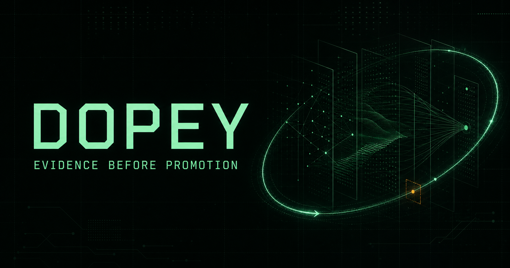
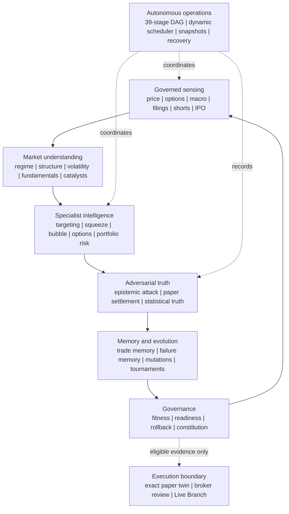
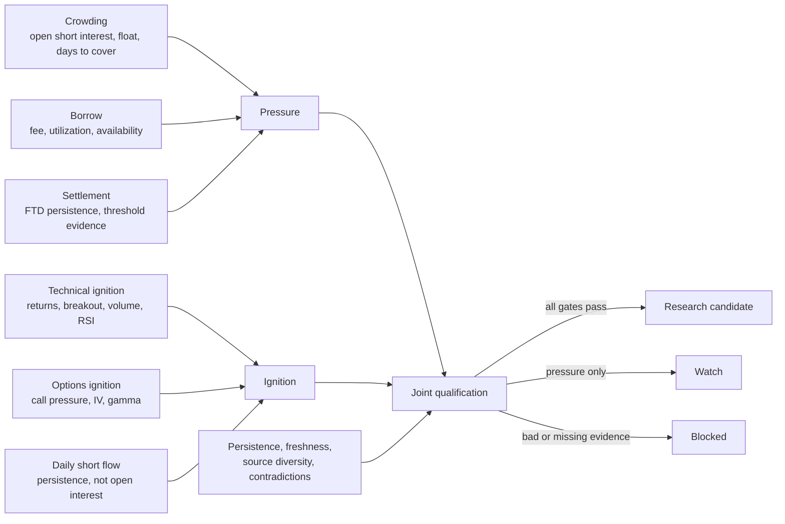
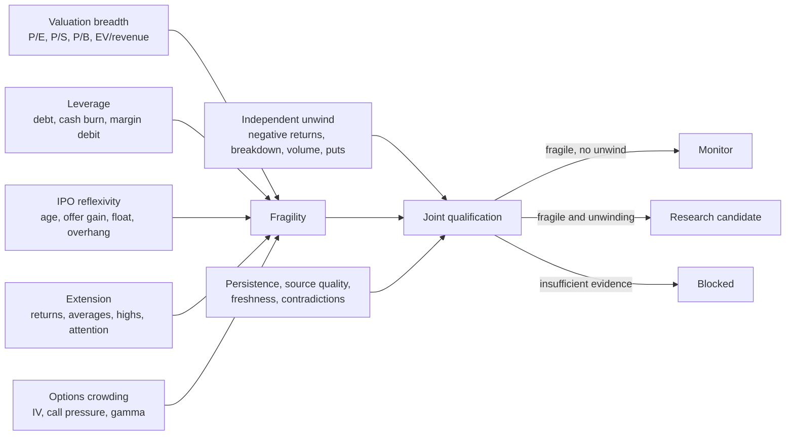
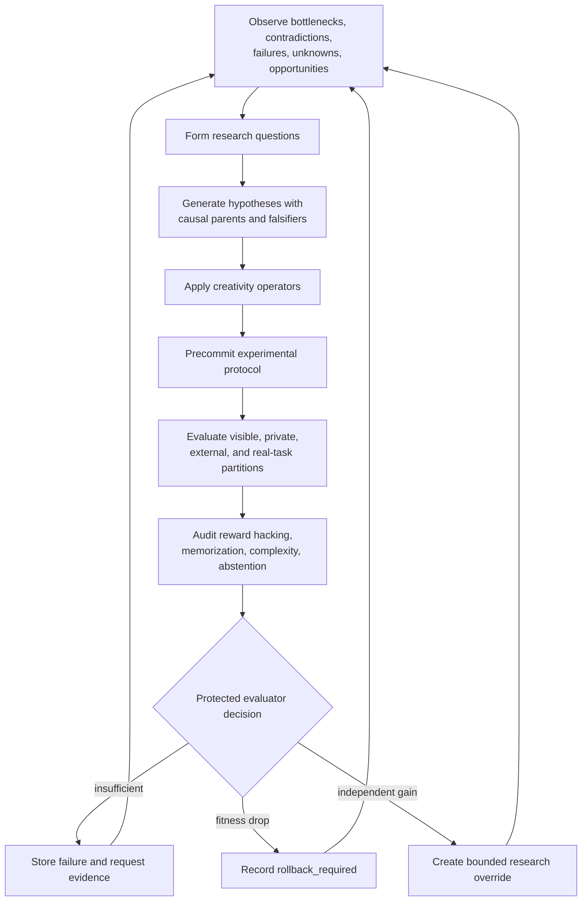
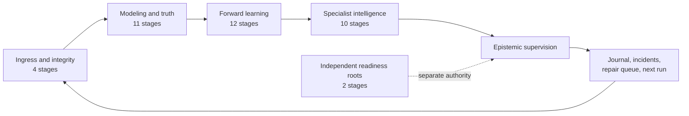
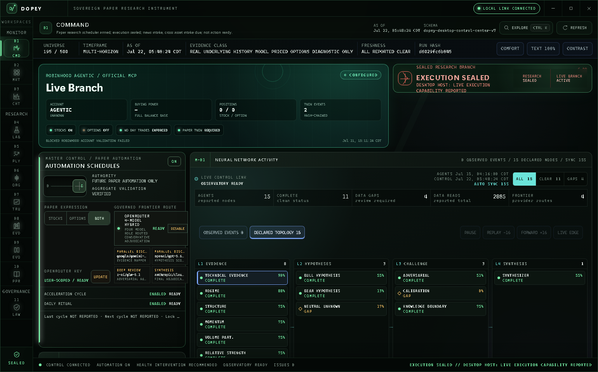
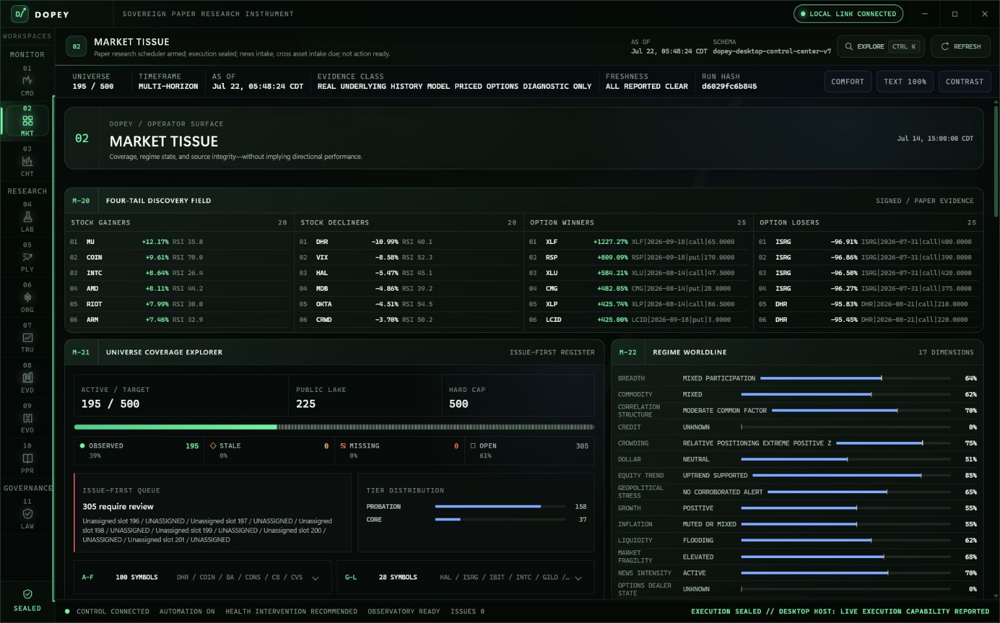
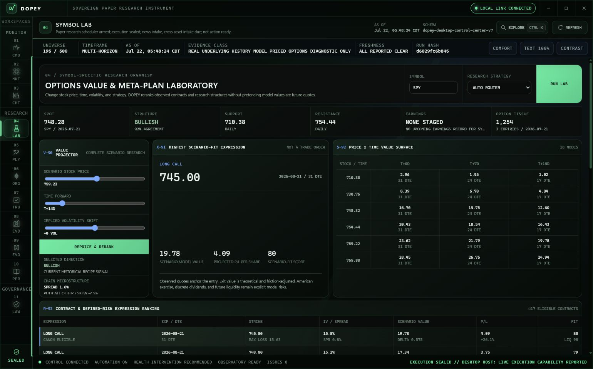
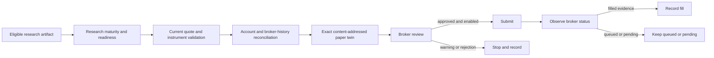

# DOPEY

<div align="center">


## Market intelligence that can improve itself without giving itself permission to lie

**Sense -> hypothesize -> falsify -> paper-test -> settle -> remember -> evolve -> govern**

[](https://github.com/ObtuseAI/dopey/actions/workflows/tests.yml)


<br>



<sub>An evidence operating system for equities, options, macro, extreme-market intelligence, autonomous research, and governed execution.</sub>

[Why DOPEY is different](#why-dopey-is-different) |
[How it works](#how-dopey-works) |
[Capability atlas](#capability-atlas) |
[Squeeze engine](#short-squeeze-intelligence) |
[Bubble engine](#bubble-leverage-ipo-and-valuation-intelligence) |
[Autonomy](#autonomy-recursive-improvement-and-dynamic-control) |
[Desktop](#native-desktop-control-center) |
[Quick start](#quick-start)

</div>

---

## What is DOPEY?

DOPEY is an autonomous, evidence-first market-intelligence operating system.
It is built to investigate equities, options, volatility, macro conditions,
market structure, short crowding, speculative bubbles, IPO reflexivity,
portfolio risk, and the quality of its own reasoning.

It is not a single model, a stock screener, a backtest notebook, or a chatbot
that produces trade ideas. It is a network of specialized research systems
connected by explicit evidence contracts:

- data must be point-in-time, attributable, fresh, and structurally valid;
- a hypothesis must identify both supporting and contradicting evidence;
- a crowded position is not a squeeze until an independent catalyst appears;
- an expensive asset is not a short until an independent unwind appears;
- a backtest is not forward evidence;
- a model price is not an executable quote;
- a queued order is not a fill;
- an improvement is not accepted until it beats its baseline under protected
  evaluation;
- missing evidence produces a blocked state, not synthetic confidence.

DOPEY is designed around a difficult question:

> How do you build a market-research system that becomes more capable,
> adaptive, and autonomous without becoming more vulnerable to overfitting,
> hindsight, duplicated evidence, stale state, fabricated certainty, or
> authority creep?

Its answer is to make truth, memory, autonomy, and execution separate systems
that must agree through typed, content-addressed artifacts.

> **Public-release truth:** a fresh clone starts with no provider market data,
> broker session, account history, credentials, private runtime lake, or
> operator-specific evidence. New intelligence begins paper-first and remains
> `not_action_ready` until the operator supplies governed data and the
> evidence gates are genuinely satisfied.

## The 30-second version

| DOPEY can | How it does it | Why that matters |
| --- | --- | --- |
| Build a complete research dossier for a symbol | Joins price, structure, fundamentals, macro, options, short interest, IPO, attention, liquidity, and provenance | A ranking is explainable as evidence, not just a score |
| Detect overshorted conditions | Separates open short interest, borrow stress, settlement stress, flow, ignition, persistence, and robustness | Crowding alone cannot masquerade as a squeeze |
| Detect bubble fragility and emerging unwinds | Separates valuation, leverage, IPO mechanics, extension, reflexivity, and downside confirmation | High P/E alone cannot become a bearish trade |
| Research option expressions | Models IV, skew, term structure, Greeks, liquidity, scenarios, and defined-risk structures | The derivative expresses an underlying thesis; it does not invent one |
| Learn per-symbol skill | Settles prior calls, collapses overlapping windows, tests chronological eras, and runs a circular-shift null | Repeated detections cannot inflate confidence |
| Evolve research methods | Generates bounded challengers, runs protected experiments, records lineage, and rolls back fitness drops | Self-improvement cannot rewrite the rules that judge it |
| Operate autonomously | Runs a dependency-aware 39-stage supervisor with locks, heartbeats, timeouts, recovery, and repair queues | A failed lane remains visible without erasing independent work |
| Preserve institutional memory | Uses immutable IDs, append-only ledgers, hashes, atomic publication, and rebuildable projections | Every conclusion can be traced to the evidence that produced it |
| Enforce a live boundary | Keeps broker authority inside `dopey_live/` and requires an exact paper twin before review | Research cannot silently become execution |

## Why DOPEY is different

Most research systems optimize for the moment a signal is produced. DOPEY
optimizes the entire epistemic lifecycle: what was known, when it was known,
how the claim was formed, how it was challenged, what decision was recorded,
what happened later, and whether the system earned the right to change.

| Conventional failure mode | DOPEY's architectural answer |
| --- | --- |
| One composite score hides why a candidate ranked | Scores are decomposed into named mechanisms, completeness, persistence, robustness, and gate reasons |
| Historical replay is presented as proof | Replay, backtest, shadow, paper, broker-read, submitted, filled, and realized evidence are separate classes |
| Multiple correlated signals are counted as independent wins | Overlapping windows, co-fired detectors, duplicate IDs, and repeated source hashes are collapsed or blocked |
| A missing feed is quietly replaced with an estimate | Missing, stale, sparse, future-dated, or invalid evidence produces typed abstention |
| A self-tuning model grades its own mutations | Candidate generation, protected evaluation, promotion, and authority are separate surfaces |
| An optimizer becomes more complex because complexity scores well | Strong simple baselines, cost stress, holdouts, complexity penalties, and rollback remain mandatory |
| A pipeline crash destroys context | Atomic artifacts, run journals, heartbeats, tombstones, idempotent IDs, and repair queues preserve the failure |
| A research score leaks into order construction | Targeting and specialist intelligence have no broker imports or order authority |
| A dashboard fills empty space with synthetic telemetry | The desktop shows unavailable data as unavailable and binds quantitative views to source artifacts |

The impressive part is not that DOPEY can produce more signals. It is that it
can produce, challenge, settle, remember, and improve research while retaining
the ability to say **no evidence**, **not enough evidence**, **contradictory
evidence**, **inconclusive timeout**, or **rollback required**.

## How DOPEY works

DOPEY is a set of interacting closed loops, not a linear
"predict and trade" script.


### A symbol's journey through the system

1. **Acquire.** A provider adapter or operator-owned import stages price,
   options, fundamental, macro, short-interest, IPO, or contextual evidence.
2. **Validate.** DOPEY verifies paths, schemas, timestamps, exchange sessions,
   numerical domains, source identity, content hashes, and freshness.
3. **Build context.** Market regime, multi-timeframe structure, volatility,
   breadth, sector/peer state, catalysts, valuation, and liquidity are joined
   without losing source lineage.
4. **Generate hypotheses.** General scanners and specialist engines propose
   directional or neutral research claims. Every hypothesis carries reasons,
   inputs, unavailable fields, and an immutable identity.
5. **Attack the claim.** Epistemic supervision checks for time travel,
   duplicated evidence, contradictory direction, missing denominators,
   outlier dominance, regime inversion, mechanical IPO effects, execution
   contamination, and promotion leakage.
6. **Express it on paper.** The system models entries, exits, transaction
   costs, spreads, slippage, path dependency, Greeks, concentration, and
   loss-limited structures.
7. **Freeze the prediction.** The pre-outcome thesis is appended before the
   future observation exists.
8. **Settle later.** Event-time settlement records what actually happened at
   defined horizons without rewriting the original thesis.
9. **Measure skill.** Calibration, hit rate, excess over drift, regime
   stability, forward-book quality, and negative controls are recomputed from
   eligible independent evidence.
10. **Learn carefully.** Research challengers may be generated, but activation
    requires protected evaluation and any measured fitness drop records
    `rollback_required`.
11. **Govern authority.** Research readiness and execution readiness remain
    different. Even eligible evidence cannot bypass the paper twin, broker
    reconciliation, account scope, risk, or operator gates.

### The core evidence contract

Every serious DOPEY artifact answers the same questions:

| Question | Required evidence |
| --- | --- |
| What is this? | Typed artifact and policy version |
| When was it knowable? | Observation and availability timestamps |
| Where did it come from? | Source IDs, paths, and content hashes |
| What generated it? | Producer version, parameters, and parent identities |
| What is missing? | Explicit gaps and completeness |
| What disagrees? | Contradiction flags and opposing evidence |
| What can consume it? | Declared dependencies and authority boundary |
| Can it be reproduced? | Canonical payload and reproducibility hash |
| Can it be promoted? | Separate truth, fitness, readiness, and authority decisions |

## System architecture



## Capability atlas

| Domain | Implemented capabilities | Primary packages |
| --- | --- | --- |
| Data and provenance | Provider ladders, local cache, staged imports, corporate actions, exchange-calendar validation, freshness, hashes, path containment, public-lake protection | [`dopey_data/`](dopey_data/), [`dopey_market_intake/`](dopey_market_intake/), [`dopey_data_ingestion/`](dopey_data_ingestion/) |
| Technical intelligence | Multi-timeframe structure, trends, ranges, support/resistance, candles, indicators, divergences, patterns, intraday structure | [`dopey/technical/`](dopey/technical/), [`dopey_analysis/`](dopey_analysis/), [`dopey_chart_vision/`](dopey_chart_vision/) |
| World and regime model | Cross-sectional state, macro families, sector/peer context, breadth, cross-asset context, market-context fusion | [`dopey/world_model/`](dopey/world_model/), [`dopey_analysis/`](dopey_analysis/) |
| Fundamentals and catalysts | Fundamental coverage, peer-relative valuation, earnings evidence, news context, catalyst identity | [`dopey/fundamentals/`](dopey/fundamentals/), [`dopey_analysis/`](dopey_analysis/), [`dopey_equity_swing/`](dopey_equity_swing/) |
| Options intelligence | Chain analytics, IV solver, volatility surface, skew, term structure, Greeks, liquidity, model repricing, contract and spread ranking | [`dopey_options/`](dopey_options/), [`dopey_options_engine/`](dopey_options_engine/) |
| Squeeze intelligence | Open-short crowding, borrow stress, FTD/threshold stress, flow, ignition, persistence, robustness, liquidity proxies | [`dopey_squeeze_bubble/`](dopey_squeeze_bubble/) |
| Bubble intelligence | P/E and valuation breadth, leverage, cash burn, market margin, IPO reflexivity, extension, options pressure, unwind confirmation | [`dopey_squeeze_bubble/`](dopey_squeeze_bubble/) |
| Per-symbol intelligence | Settled playbook skill, overlap collapse, chronological-era tests, circular-shift nulls, immutable candidate generations | [`dopey_targeting/`](dopey_targeting/), [`dopey/strategy_engineering/`](dopey/strategy_engineering/) |
| Strategy research | Playbooks, baselines, challengers, honest backtests, purged rolling origin, era walk-forward, forward paper walk | [`dopey_backtest/`](dopey_backtest/), [`dopey_strategy_lab/`](dopey_strategy_lab/), [`dopey_walk_forward/`](dopey_walk_forward/) |
| Statistical and causal truth | Selection-aware truth, negative controls, causal evaluation, cohort analysis, calibration, abstention | [`dopey/truth/`](dopey/truth/), [`dopey_stats/`](dopey_stats/), [`dopey_calibration/`](dopey_calibration/) |
| Portfolio and risk | Exposure policy, capacity, risk throttles, stress ladders, crisis mode, exit policy, drawdown, concentration, kill switches | [`dopey_portfolio/`](dopey_portfolio/), [`dopey_risk_engine/`](dopey_risk_engine/), [`dopey_governor/`](dopey_governor/) |
| Autonomous research | Invention, experiments, evidence synthesis, mutation genealogy, fitness quarantine, tournaments, rollback | [`dopey/autoresearch/`](dopey/autoresearch/), [`dopey_evolution/`](dopey_evolution/), [`dopey_fitness/`](dopey_fitness/) |
| Metacognition | Confidence, calibration, abstention, disagreement, difficulty, resource control, knowledge boundaries, strategy selection | [`dopey/metacognition/`](dopey/metacognition/) |
| Durable memory | Immutable predictions, settlements, trade memory, source registry, content-addressed generations, SQLite projection | [`dopey/strategy_engineering/`](dopey/strategy_engineering/), [`dopey_audit/`](dopey_audit/) |
| Resilient operations | 39-stage DAG, dynamic scheduling, snapshots, locks, heartbeats, timeouts, process-tree termination, recovery, repair queues | [`dopey_autonomy/`](dopey_autonomy/), [`dopey_acceleration/`](dopey_acceleration/), [`dopey_ops/`](dopey_ops/) |
| Operator experience | Native React control center, command palette, Market Tissue, Symbol Lab, Evidence, Truth, Evolution, Constitution, Paper, Playbooks | [`desktop/`](desktop/) |
| Governed execution | Exact paper twins, account attestation, reconciliation, immutable intents, no-day-trade guard, broker outcome evidence | [`dopey_live/`](dopey_live/), [`dopey_execution/`](dopey_execution/), [`dopey_broker_readiness/`](dopey_broker_readiness/) |

## Market sensing and data intelligence

DOPEY treats data quality as model quality. A sophisticated model operating on
stale, future-dated, malformed, or misidentified evidence is considered worse
than a simple model that abstains.

### What it can ingest

- daily and intraday OHLCV history;
- corporate actions and adjusted-history metadata;
- option chains and quote snapshots;
- fundamentals, earnings, and filing-derived evidence;
- rates, yield curves, inflation, labor, liquidity, credit, and volatility
  context;
- sector, peer, breadth, and cross-asset context;
- short interest, daily short-sale flow, fails to deliver, threshold lists,
  and licensed borrow evidence when available;
- IPO calendars, offer metadata, listing age, float, lock-up, and overhang
  context;
- news, attention, and event ledgers.

### What happens before evidence is accepted

| Control | Behavior |
| --- | --- |
| Path containment | Rejects absolute paths, parent traversal, and data outside governed roots |
| Source identity | Requires stable provider/source IDs and content hashes |
| Timestamp semantics | Separates observation time from availability time and rejects future evidence |
| Exchange calendar | Detects actual missing sessions without treating exchange holidays as gaps |
| Numerical integrity | Rejects nonfinite values, nonpositive prices, negative volume, and inconsistent OHLC rows |
| Freshness | Records lane age and prevents stale evidence from entering eligible decisions |
| Atomic publication | Writes, flushes, fsyncs, and atomically replaces critical artifacts |
| Provider isolation | A provider failure remains attributable; it cannot silently become another provider's success |
| Public-lake protection | Test extraction and operational market data remain separated |

The provider ladder and adapters are not permission to download or redistribute
market data. Operators are responsible for licensing and stage their own data
outside Git history under [`DATA_NOTICE.md`](DATA_NOTICE.md).

## Market structure and contextual intelligence

DOPEY builds a market state before it asks for a trade direction.

### Technical structure

- multi-timeframe trend and range state;
- support, resistance, breakouts, breakdowns, and compression/expansion;
- candle and pattern evidence;
- RSI and momentum state;
- realized volatility and volatility acceleration;
- price/volume divergence and signed-volume pressure;
- moving-average distance and 52-week extension;
- intraday structure when governed intraday data exists.

### Contextual structure

- market regime and cross-sectional state;
- sector and peer-relative conditions;
- macro-event families and cross-asset transmission;
- breadth, volatility regime, rates, credit, and liquidity conditions;
- fundamentals, earnings, catalysts, and attention;
- explicit context gaps when a source is unavailable.

The same technical feature can mean different things in different contexts.
For example, high RSI can be exhaustion inside a weakening bubble, persistent
strength inside a squeeze ignition, or noise inside a low-liquidity range.
DOPEY does not assign it one universal direction.

## Short-squeeze intelligence

DOPEY's squeeze engine is built around one central distinction:

> **Overshorted pressure is stored energy. Price/volume/options ignition is the
> independent event that may release it.**

The engine does not use daily short volume as a substitute for open short
interest, and it does not treat a negative-gamma estimate as automatically
bullish. It constructs multiple independent layers.



### Squeeze evidence stack

| Layer | Evidence used | Question answered |
| --- | --- | --- |
| Open-short pressure | Shares short, short percent of float, days to cover, two-period short growth, float scarcity | Is positioning structurally crowded? |
| Borrow stress | Borrow fee, utilization, shares available | Is maintaining or expanding the short becoming difficult? |
| Settlement stress | Fails-to-deliver observations, consecutive elevated sessions, official threshold evidence | Is settlement pressure persistent? |
| Short-flow persistence | Daily short-sale ratio, median, dispersion, elevated-session count | Is short-sale flow sustained? |
| Technical ignition | 5-day and 20-day return, breakout, volume expansion, RSI | Has price action independently activated the setup? |
| Options pressure | Call volume/open interest, put-call ratios, IV, quote-derived gamma | Is derivatives activity reinforcing the move? |
| Liquidity stress | Float turnover, borrow scarcity, call turnover, signed volume, dollar-volume change | Could constrained liquidity amplify price movement? |
| Durability | Multi-session flow, multi-horizon return confirmation, consecutive settlement stress | Is the condition persistent rather than a one-day spike? |
| Robustness | Freshness, source diversity, observation strength, contradiction count | Is the evidence trustworthy enough to rank? |

### Conservative default admission policy

The current versioned research defaults in
[`dopey_squeeze_bubble/models.py`](dopey_squeeze_bubble/models.py) require:

- at least $10 million of 20-day average dollar volume;
- squeeze pressure of at least `0.45`;
- independent ignition of at least `0.50`;
- persistence of at least `0.45`;
- lane robustness of at least `0.60`;
- at least three independent sources;
- zero accepted contradiction flags;
- current technical evidence;
- actual open short interest;
- sufficient option rows when quote-derived options evidence is present.

These values are research-policy gates, not probabilities and not universal
market truths. A score of `0.80` does not mean an 80% chance of a squeeze.

### Squeeze outputs

For every represented symbol, DOPEY emits:

- component scores and raw source references;
- pressure, ignition, persistence, completeness, and robustness;
- missing and stale lanes;
- contradiction flags;
- liquidity-stress proxy diagnostics;
- exact gate reasons;
- candidate, watch, or blocked state;
- a stable signal identity for later forward settlement;
- 2-, 5-, and 10-session forward-evidence slots.

The candidate lane is research-only. It can suggest that a long-equity
expression deserves later review; it cannot create an order.

### What it deliberately refuses to infer

- Daily short-sale volume is not open short interest.
- Fails to deliver are not proof of abusive or naked shorting.
- Off-exchange volume is not participant intent.
- Negative gamma is not automatically directional.
- A high short-interest percentage without ignition is a watch, not a squeeze.
- Observable liquidity proxies are not a consolidated order book.

The source semantics follow the public descriptions from
[FINRA short interest](https://www.finra.org/investors/insights/short-interest),
[FINRA short-sale volume](https://www.finra.org/filing-reporting/trf/finra-equity-short-sale-volume-files),
and [SEC fails-to-deliver data](https://www.sec.gov/data-research/sec-markets-data/fails-deliver-data).

## Bubble, leverage, IPO, and valuation intelligence

DOPEY's bubble engine separates two events that are often confused:

1. **Fragility:** valuation, leverage, extension, float structure, attention,
   or options positioning make an asset vulnerable.
2. **Unwind:** independent downside behavior shows that the fragile structure
   is actually breaking.



### Fragility intelligence

| Family | Evidence | Why it is not enough alone |
| --- | --- | --- |
| Earnings valuation | Trailing P/E and forward P/E | Earnings can be temporarily depressed or rapidly growing |
| Revenue valuation | Price-to-sales and enterprise-value-to-revenue | Revenue multiples require margin, growth, and sector context |
| Balance-sheet valuation | Price-to-book | Book value has different meaning across industries |
| Cash quality | Profit margin, free cash flow, cash burn | Negative cash flow can be planned investment rather than distress |
| Leverage | Debt, cash, net leverage, market-wide margin debit | Leverage is vulnerability, not timing |
| Price extension | 63-day and 252-day return, moving-average distance, distance from highs | Momentum can persist |
| Reflexivity | Attention, turnover, call crowding, IV, gamma, liquidity | Reflexivity can amplify in either direction |
| Valuation breadth | Multiple independent valuation families | A broader excess is more informative than one extreme ratio |

### IPO intelligence

The IPO lane evaluates:

- days since first trade;
- offer price and appreciation from the offer;
- deal size;
- float constraints;
- listing status;
- lock-up and supply-overhang context when available;
- minimum history needed for technical features;
- nonmechanical evidence beyond "this company is newly listed."

Blank-check companies, acquisition vehicles, ETFs, units, warrants, rights,
and obvious non-operating offerings are excluded from the operating-company
IPO lane.

A recent IPO can enter technical research after enough sessions exist, but
unavailable long-horizon features reduce completeness. Recent-listing
mechanics cannot independently create a bearish candidate.

### Unwind confirmation

An actionable research candidate requires evidence such as:

- negative 5-day and 20-day return;
- loss of the 20-day, 50-day, or 200-day structure;
- a confirmed 20-day breakdown;
- downside volume expansion;
- put pressure;
- negative gamma in a weakening structure;
- an observable liquidity air pocket.

The current default policy requires bubble fragility of at least `0.58`,
unwind confirmation of at least `0.42`, completeness of at least `0.55`,
persistence of at least `0.40`, robustness of at least `0.60`, three
independent sources, no contradictions, an empirical valuation or IPO anchor,
and a current quote-derived option chain for candidate status.

Fragility of at least `0.20` may remain visible as a monitor when the stronger
candidate gates are not satisfied.

### Loss-limited expression policy

A qualified unwind may propose a long put or bear-put debit spread for later
governed review. It cannot produce:

- a naked short stock position;
- a naked short option;
- undefined-loss exposure;
- a same-session round trip;
- an order that bypasses option controls, liquidity, readiness, or the paper
  twin.

The source semantics use public definitions such as
[Investor.gov's P/E explanation](https://www.investor.gov/introduction-investing/investing-basics/glossary/price-earnings-pe-ratio),
[FINRA margin statistics](https://www.finra.org/rules-guidance/key-topics/margin-accounts/margin-statistics),
and the [SEC IPO investor bulletin](https://www.investor.gov/introduction-investing/general-resources/news-alerts/alerts-bulletins/17).

## Observable liquidity intelligence

DOPEY can reason about visible liquidity stress through:

- bid/ask width and quote validity;
- average and recent dollar volume;
- float turnover;
- signed-volume pressure;
- persistent reported short flow;
- borrow availability and fee when licensed evidence exists;
- option open interest and volume turnover;
- quote-derived gamma;
- modeled slippage and stressed exits.

It intentionally records:

`direct_hidden_liquidity_observed=false`

Without licensed order-book, securities-lending, or participant-level data,
DOPEY does not claim to see hidden intent, dealer inventory, dark-pool
motivation, or a consolidated queue.

## Options intelligence

Options are a research and expression layer, not a source of magical
direction.

### Chain and volatility capabilities

- strict option identity and chain snapshot loading;
- bid, ask, midpoint, spread, open-interest, and volume validation;
- implied-volatility solving;
- volatility-surface construction;
- strike skew and maturity term structure;
- volatility-regime classification;
- delta, gamma, theta, vega, and higher-order diagnostics where supported;
- gamma-exposure and flip-level research;
- model repricing across spot, time, IV, and rate scenarios;
- contract ranking by thesis fit, liquidity, convexity, and cost;
- long-premium and defined-risk spread construction;
- assignment, exercise, expiry, and lifecycle research;
- 0DTE replay, adversarial paths, threshold feedback, and cross-underlying
  research corpora.

### The pricing hierarchy

| Price class | Meaning | Can prove execution? |
| --- | --- | ---: |
| Model value | Deterministic theoretical valuation | No |
| Observed midpoint | Midpoint of a valid historical/current quote | No |
| Conservative paper-executable value | Haircut or spread-aware research mark | No |
| Broker review result | Broker-side pre-trade response | No |
| Submitted order | Broker accepted an order request | No |
| Broker fill | Broker reports an execution | Yes, for execution only |
| Realized P&L | Settled result after the position lifecycle | Yes, for that outcome |

DOPEY keeps these classes separate because collapsing them is one of the
fastest ways for an options system to deceive itself.

## Per-symbol targeting

The targeting system asks a harder question than "which symbols score
highest?":

> Has this exact symbol, under this strategy family and detector, demonstrated
> repeatable directional skill after overlap, drift, chronology, and chance
> are considered?

### How skill is measured

1. Load only direction-graded, policy-eligible settlements.
2. Quarantine legacy assumptions and invalid framing.
3. Deduplicate immutable detection IDs.
4. Collapse overlapping forward windows into one effective observation.
5. Measure directional excess over horizon-adjusted prior drift.
6. Measure directional hit rate.
7. Split observations into chronological halves.
8. Require each era to satisfy its sample and direction floors.
9. Run a deterministic circular-shift null against accidental timing.
10. Assign `positive_verified`, `negative_verified`, `flat`, or
    `insufficient_evidence`.

### Default targeting gates

| Gate | Default |
| --- | ---: |
| Effective independent observations | 30 |
| Observations in each chronological era | 10 |
| Positive excess over drift | 0.002 |
| Positive directional hit rate | 0.52 |
| Negative directional hit-rate ceiling | 0.48 |
| Maximum circular-shift null p-value | 0.10 |
| Minimum average dollar volume | $5 million |
| Maximum selected paper-shadow candidates | 20 |
| Maximum candidates per direction | 10 |
| Maximum symbol weight | 10% |
| Reference option horizon | 30 DTE |

Scanner fitness remains aggregate unless symbol-level point-in-time evidence
exists. DOPEY refuses to smear an aggregate scanner score across individual
symbols. Rank IC remains unavailable until detections carry a valid continuous
point-in-time score.

### Candidate generations

Candidate registries are written as immutable generations before a stable
pointer can move. Shadow selections:

- embed the decisive candidate fields;
- deduplicate by immutable source detection ID;
- enforce weight, direction, and symbol caps;
- retain blocked candidates rather than deleting them;
- never read broker positions, live-book state, order constructors, or action
  readiness.

## Strategy research and forward evidence

DOPEY studies strategies as contested scientific claims.

### Research sequence


### What the research stack can evaluate

- simple and complex baselines under the same data;
- detector families and playbook families;
- long, short, neutral, and volatility hypotheses;
- entry, marking, expiry, and exit policies;
- transaction costs, spreads, liquidity, and slippage;
- purged rolling-origin splits;
- held-out eras and regime cells;
- selection effects and multiple testing;
- forward paper predictions;
- calibration and abstention;
- book-level stress and concentration;
- capacity as a reason to reduce confidence, never increase it.

### Evidence that does not promote

- synthetic fixtures;
- model-priced options;
- historical replay alone;
- four-trade anecdotes;
- duplicated detector firings;
- a full-suite timeout with no captured failure;
- a high diagnostic fitness score when statistical truth is blocked;
- a candidate's self-reported improvement.

## Epistemic supervision

The epistemic supervisor is an adversary, not a second signal generator. It
can preserve a research claim, downgrade it, block it, or mark it
inconclusive. It cannot promote a candidate or grant execution authority.

### Attacks it performs

| Attack | Detection | Result |
| --- | --- | --- |
| Stale evidence | Evidence age exceeds the versioned maximum | Block |
| Future information | Availability time is after the claim cutoff | Block |
| Non-point-in-time source | Source cannot establish what was knowable | Block |
| Duplicate identity | Same evidence ID appears more than once | Block |
| Relabeled duplicate | Different IDs share the same source hash/fingerprint | Block |
| Contradictory direction | Evidence family or aggregate effect disagrees with the claim | Block |
| Missing denominator | Rate or effect lacks the required population | Block |
| Invalid weight/value | Nonfinite, negative, or empty contribution | Block |
| Outlier domination | One observation dominates weight or contribution | Block |
| Regime inversion | Aggregate effect reverses across adequate regime cells | Block or inconclusive |
| Crowding without catalyst | Squeeze pressure lacks an independent ignition family | Block |
| Mechanical IPO story | Recent listing lacks nonmechanical evidence and unwind | Block |
| Sector mismatch | Valuation comparison lacks issuer/peer sector identity | Block |
| Execution contamination | Research evidence comes from simulated/live/broker/order layers | Block |
| Fitness laundering | Holdout reuse, negative delta, bad lineage, or blocked upstream status | Block |
| Status laundering | Existing blocked, missing, invalid, timeout, or inconclusive state is softened | Preserve exact status |

### Default epistemic floors

The versioned baseline in
[`dopey_validation/epistemic_adversary.py`](dopey_validation/epistemic_adversary.py)
uses:

- maximum evidence age of three days;
- maximum future-clock skew of 60 seconds;
- zero tolerated duplicate fraction;
- denominator floor of 20;
- maximum single-observation weight of 35%;
- maximum single-contribution share of 50%;
- at least 20 observations per regime cell;
- at least three independent regimes;
- a 90-day mechanical recent-IPO window;
- at least four evidence points.

These are explicit policy values, so changes are reviewable and testable.

## Autonomy, recursive improvement, and dynamic control

DOPEY uses **RSI** in two distinct ways:

- market RSI, such as RSI-14, is one technical feature among many;
- recursive/self-improving intelligence is the governed process that studies
  how DOPEY researches, tests, and allocates attention.

The second meaning is the important architectural one.

### What DOPEY may adapt

- research depth;
- agent or method selection;
- evidence requests;
- replay count;
- early stopping;
- abstention;
- bounded research cadence;
- bounded research configuration inside sealed ranges;
- universe attention and stale-lane priority.

### What DOPEY may never adapt

- constitutional truth rules;
- readiness thresholds;
- execution seals;
- source provenance requirements;
- settlement definitions;
- autonomous-promotion thresholds;
- broker authority;
- credential access;
- evidence floors;
- the meaning of filled, realized, or forward.

### The recursive research loop



### Computational creativity

The intelligence-research layer can generate method challengers through:

1. analogy;
2. inversion;
3. morphological search;
4. constraint inversion;
5. recombination;
6. counterfactual reasoning;
7. first-principles reconstruction;
8. abstraction.

Each output must define:

- the independent variable;
- dependent metrics;
- a falsifiable prediction;
- evidence parents;
- failure conditions;
- a bounded experimental protocol.

Creative output remains experimental. It does not receive truth, permission,
readiness, or execution authority.

### Protected improvement

A research mutation must:

- target an allowed surface;
- stay inside sealed numerical ranges;
- carry an immutable proposal identity;
- meet a minimum sample requirement;
- have a positive lower effect bound;
- remain inside its cost ratio;
- use an evaluator independent from the proposer;
- be deterministic;
- have no invariant violations.

The mutation ledger stores baseline hash, candidate hash, measured fitness,
delta, decision, evidence, and rollback evidence in an append-only hash chain.
A fitness drop always produces `rollback_required`; equal fitness does not
become improvement.

### Transactional system snapshots

Before cross-system decisions, DOPEY can build a `SystemSnapshot` that binds:

- exact source-file hashes;
- exact projection hashes;
- active-universe identity;
- readiness identity;
- paper/live boundary assertions;
- one content-addressed snapshot ID.

This prevents different subsystems from reasoning over incompatible moments
while believing they share the same state.

### Dynamic scheduling

The scheduler prioritizes:

1. lanes that have never produced verified evidence;
2. lanes whose last verified success is stalest;
3. overdue work inside its allowed window;
4. dependencies that must be refreshed first.

It also responds to:

- storage pressure;
- reliability error budgets;
- previous duration and variance;
- active supervisor ownership;
- stale or dead locks;
- partial valid JUnit evidence;
- external provider degradation.

Dynamic does not mean reckless. Storage pressure can block write-heavy lanes,
reliability deterioration can roll cadence back, and no scheduler decision can
lower an evidence threshold.

## The 39-stage resilient supervisor

The supervisor is a dependency-aware research DAG. It follows
**absorb -> record -> continue**:

- a failed producer blocks its consumers;
- independent stages continue;
- blocked dependencies retain their causal reason;
- every stage records start, end, duration, status, and identity;
- long stages publish heartbeats;
- hard timeouts terminate process trees;
- crashes and lock recovery produce durable evidence;
- repair items identify the failed stage and suggested next action.



### Complete stage inventory

| Group | Stages | Purpose |
| --- | --- | --- |
| Ingress and integrity (4) | `data_freshness_sentinel`, `envelope_integrity_sentinel`, `macro_context_gate`, `history_validation` | Establish whether source evidence is current, contained, coherent, and usable |
| Modeling and truth (11) | `real_signals`, `market_structure`, `model_iv_calibration`, `real_backtest`, `baseline_arbitration`, `era_walk_forward`, `statistical_truth`, `truth_gated_fitness`, `chain_analytics_gate`, `vol_surface_metrics`, `market_context_fusion` | Build and challenge the analytical state |
| Forward and operational learning (12) | `forward_paper_walk`, `straddle_vrp_probe`, `pipeline_forecast_card`, `reliability_slo`, `forward_book_quality`, `forward_book_risk`, `adversarial_stress`, `kaizen_ledger`, `distributional_stress`, `exit_playbook`, `signal_calibration`, `playbook_research` | Freeze decisions, observe outcomes, stress the book, and learn |
| Specialist intelligence (10) | `symbol_targeting`, `squeeze_bubble_intelligence`, `epistemic_supervision`, `adversarial_signal_panel`, `trade_loss_coach`, `target_screener`, `universe_governor`, `exit_policy_search`, `chart_vision`, `indicator_foundry` | Run focused research and adversarial review |
| Independent readiness roots (2) | `agentic_account_reconciliation`, `action_readiness_gate` | Observe readiness without becoming dependencies of research intelligence |

The supervisor's 39th stage, `epistemic_supervision`, consumes current
targeting and squeeze/bubble artifacts and can only preserve or downgrade
their claims.

## Durable evidence and institutional memory

DOPEY's memory is not a chat transcript. It is a set of immutable event
histories and content-addressed projections.

### What is remembered

- raw source identities and validation receipts;
- hypotheses and pre-outcome predictions;
- detector and playbook decisions;
- paper entries, marks, exits, and settlements;
- context, regime, cohort, and era attribution;
- calibration and abstention outcomes;
- failed experiments and negative controls;
- mutation parents, candidates, evaluations, and rollbacks;
- incidents, timeouts, degraded stages, and repair items;
- broker reviews, submissions, fills, rejections, and paper-twin links when
  the separate Live Branch is explicitly operated.

### Durability controls

| Control | Protection |
| --- | --- |
| Immutable IDs | The same economic event cannot silently acquire a new identity |
| Append-only JSONL | Prior predictions and failures remain visible |
| Hash chaining | Mutation and execution history exposes deletion or reordering |
| Content-addressed generations | A stable alias cannot overwrite the authoritative generation |
| Atomic fsync-and-replace | Critical JSON publication survives partial writes |
| Pinned head records | Truncation or anchor mismatch blocks future mutation |
| Rebuildable SQLite | Fast queries remain projections of the authoritative ledger |
| Accounting identity | Premium, P&L, and return must reconcile |
| Fanout reporting | Repeated family views cannot masquerade as unique trades |
| Strict UTF-8 | Invalid encoding fails validation instead of corrupting evidence |

## Portfolio, risk, and survival intelligence

DOPEY treats risk as a research input and an authority constraint, not a chart
added after strategy selection.

### Portfolio capabilities

- symbol, sector, family, direction, and regime concentration;
- premium and notional exposure;
- capacity based on executable contracts and liquidity;
- delta, gamma, theta, and vega attribution;
- correlation and crowding stress;
- drawdown and loss-streak throttles;
- deterministic scenario repricing;
- crisis stress ladders and recovery policy;
- exit playbooks and lifecycle state;
- paper-only kill switches;
- no-day-trade guards;
- proof-weighted allocation.

Capacity can only reduce a candidate's viability. It cannot make weak evidence
look stronger.

For long-premium options, loss is bounded by premium at the position level,
but DOPEY still tests book-level concentration, liquidity-hole exits, IV
collapse, time decay, correlated loss, and stressed marks.

## Native desktop control center

The React 19 desktop turns the evidence graph into an operator-readable
control surface.



<sub>Source-backed 1540 x 960 visual-QA capture. Broker identifiers are
redacted and the deterministic capture bridge has no mutation authority.</sub>

### Operator workspaces

| Workspace | What it reveals |
| --- | --- |
| Command | Current system posture, research routing, schedules, blockers, and permitted operator actions |
| Market Tissue | Universe coverage, regime dimensions, cross-sectional state, source integrity, and extreme-condition discovery |
| Symbol Lab | Per-symbol structure, options scenarios, contract ranking, evidence gaps, and meta-plan |
| Chart | Price, structure, indicators, signals, and provenance-bound visual analysis |
| Playbooks | Strategy families, current detections, settlements, trust, and contested evidence |
| Paper | Frozen hypotheses, open paper positions, marks, exits, and outcomes |
| Evidence | Data contracts, capital diagnostics, mutation genealogy, and source integrity |
| Truth | Statistical gates, calibration, negative controls, contradictions, and promotion state |
| Evolution | Candidate populations, mutation lineage, tournaments, and rollback state |
| Organisms | Specialized research agents and their evidence contribution |
| Constitution | Protected laws, authority boundaries, and execution seal |

| Market Tissue | Symbol Lab |
| --- | --- |
|  |  |
| Universe, regime, source integrity, and four-tail discovery | Structure, scenarios, contract research, and evidence-bound planning |

Every quantitative visualization has a table, provenance surface, and method
explanation. Missing telemetry remains missing; the interface does not animate
fictional market activity.

## Research authority and the Live Branch

DOPEY deliberately separates research capability from broker capability.

| Plane | Responsibility | Authority |
| --- | --- | --- |
| Research plane | Observe, model, rank, falsify, replay, paper-test, settle, and learn | No broker authority |
| Readiness plane | Determine whether evidence and operational prerequisites are satisfied | Cannot create an order |
| Live Branch | Reconcile the dedicated account, stage paper twins, review eligible intents, and record broker outcomes | Sole broker-capable package |

### Required live sequence



Critical rules:

- `dopey_live/` is the only broker-capable package.
- Every eligible live decision stages an exact paper twin first.
- Immutable intent IDs make scheduler retries idempotent.
- The no-day-trade guard prohibits same-session round trips.
- Missing broker history or a local order absent from broker history fails
  closed.
- A review, submission, queue, partial fill, fill, rejection, and realized
  outcome are different states.
- Long-premium and defined-risk option capability exists in code but remains
  owner-disabled by default.
- The public repository contains no credentials or authenticated broker
  session.

Read the full authority contract in
[`DOPEY_CONSTITUTION.md`](DOPEY_CONSTITUTION.md).

## Why the architecture is impressive

### 1. It models mechanisms, not just correlations

The squeeze engine separates pressure from ignition. The bubble engine
separates fragility from unwind. The options layer separates underlying thesis
from derivative expression. This makes the system's reasoning falsifiable.

### 2. It treats abstention as intelligence

DOPEY can represent every symbol while selecting none. A zero-candidate result
can be the correct result. Missing data, weak denominators, contradictory
regimes, or unverified execution evidence do not need to be converted into a
trade for the run to be useful.

### 3. It remembers what it believed before the answer existed

Predictions are frozen before settlement. That makes calibration, failure
analysis, and learning meaningful. A model cannot quietly rewrite its old
thesis after seeing the outcome.

### 4. It can improve its research without mutating its constitution

The system may explore methods, schedules, research depth, and bounded
parameters, but the rules for truth, provenance, settlement, readiness, and
execution are protected surfaces.

### 5. It makes corruption and self-deception observable

Duplicate evidence, hash mismatches, invalid lineage, stale artifacts,
selection leakage, outlier domination, and status laundering are explicit
failure modes with explicit reason codes.

### 6. It connects intelligence to operations

The 39-stage supervisor, dynamic scheduler, locks, heartbeats, timeouts,
process-tree termination, storage backpressure, repair queues, and
transactional snapshots make the research system durable enough to operate
repeatedly rather than only inside a notebook.

### 7. It keeps market ambition separate from execution authority

DOPEY can be aggressive about searching for edge and conservative about
acting on it. Squeeze, bubble, targeting, mutation, and epistemic layers cannot
construct orders.

## Repository map

```text
dopey/                    constitutional core, technicals, truth, memory, metacognition
dopey_data/               governed history, source registry, adapters, validation
dopey_market_intake/      provider ladder, cache, public-lake guards, macro gate
dopey_analysis/           signals, structure, fundamentals, macro, context fusion
dopey_options/            chains, IV, Greeks, skew, term, repricing, lifecycle
dopey_targeting/          per-symbol skill and immutable shadow targeting
dopey_squeeze_bubble/     squeeze, bubble, IPO, leverage, liquidity, settlement
dopey_validation/         epistemic adversary, preflights, release validation
dopey_autonomy/           dependency-aware 39-stage research supervisor
dopey_acceleration/       scheduling, snapshots, reliability, capability discovery
dopey_backtest/           honest backtests, baselines, purged eras, paper walk
dopey_fitness/            truth-gated fitness and proxy-fitness quarantine
dopey_audit/              lineage, evidence inventory, replay and mutation audit
dopey_portfolio/           exposure, rotation, stress ladders, crisis policy
dopey_risk_engine/        book risk, stress, capacity, exits, kill switches
dopey_live/               sole broker-capable package and paper-twin boundary
desktop/                  React 19 native operator control center
operator_tools/           bounded operator entry points and scheduling
verifier/                 protected manifests, paths, environment, release audit
tests/                    integration, safety, evidence, and release proof
```

## Quick start

DOPEY is developed and operated on Windows with PowerShell.

### Install

```powershell
git clone https://github.com/ObtuseAI/dopey.git
cd dopey

py -3.11 -m venv .venv
.venv\Scripts\python.exe -m pip install --upgrade pip
.venv\Scripts\python.exe -m pip install -e ".[dev,desktop]"
```

### Validate the public checkout

```powershell
.venv\Scripts\python.exe -m ruff check .
.venv\Scripts\python.exe -m pytest --collect-only -q
.venv\Scripts\python.exe -m pip check
.venv\Scripts\python.exe -m operator_tools.verify_public_source_boundary
```

### Stage operator-owned data

Read [`DATA_NOTICE.md`](DATA_NOTICE.md) before introducing any market data.

```powershell
.venv\Scripts\python.exe operator_tools\operator_fetch_daily_ohlcv.py --help
.venv\Scripts\python.exe operator_tools\operator_fetch_option_chains.py --help
.venv\Scripts\python.exe operator_tools\operator_fetch_macro_context.py --help
.venv\Scripts\python.exe operator_tools\operator_fetch_squeeze_context.py --help
.venv\Scripts\python.exe operator_tools\operator_fetch_bubble_context.py --help
```

### Run bounded research surfaces

```powershell
# Missing or stale governed inputs produce typed blocked states.
.venv\Scripts\python.exe -m dopey_targeting.runtime
.venv\Scripts\python.exe -m dopey_squeeze_bubble.runtime
.venv\Scripts\python.exe -m dopey_autonomy.run_resilient_research_supervisor
```

### Build the desktop

```powershell
cd desktop
npm.cmd ci
npm.cmd run typecheck
npm.cmd run build
.\launch_desktop.ps1
```

Repository commands do not configure credentials, scrape tokens, or silently
arm live execution.

## Public data boundary

The public release includes:

- source code;
- schemas and templates;
- deterministic synthetic/test fixtures;
- aggregate engineering validation metadata;
- one hash-pinned, test-only archive of derived paper-research outputs.

It excludes:

- raw provider market datasets;
- the operator's historical and current market lake;
- broker exports and account history;
- credentials, tokens, and authenticated sessions;
- private runtime ledgers;
- private session and handoff reports;
- operator-specific agent configuration.

The test-only archive is extracted into isolated temporary directories. It
cannot seed the operational market lake, forward evidence, or live state.

The machine-readable boundary is recorded in
[`PUBLIC_SOURCE_MANIFEST.json`](PUBLIC_SOURCE_MANIFEST.json).

## Validation state

| Validation surface | Verified release result | Interpretation |
| --- | ---: | --- |
| Required deterministic CI gate | 1,245 / 1,245 passed | Protected release subset is green |
| CI shard 1 | 332 passed | Green |
| CI shard 2 | 272 passed | Green |
| CI shard 3 | 305 passed | Green |
| CI shard 4 | 336 passed | Green |
| Desktop | Typecheck and production build passed | Operator UI compiles |
| CI manifest | 70 files, 1,245 unique nodes, 0 duplicates | Stable content-addressed sharding |
| Repository collection | 4,334 collected, 0 collection errors | Full suite remains discoverable |
| Public source boundary | Verified | No provider lake, broker history, or credentials |
| Public source secret scan | 0 Gitleaks findings at release | No detected committed secret |
| Focused market and supervisor integration | 50 passed | Squeeze, bubble, targeting, epistemic, supervisor integration |
| Focused CI and mutation-ledger integration | 13 passed | Sharding, worktree purity, hash chain, rollback |

A repository-wide 4,332-test execution reached its 15-minute boundary without
a captured failure and remains `inconclusive_timeout`, not pass. The
deterministic required CI subset is the authoritative release gate.

The squeeze/bubble and epistemic engines are implementation, adversarial-test,
and CI-gate proven. That does not mean they have proven a profitable edge or
completed sufficient prospective forward observations.

## Current honest limitations

1. The public clone contains no operational provider data and therefore begins
   with typed missing-data states.
2. Current-policy detections must mature and settle before per-symbol targeting
   can earn verified candidates.
3. Research readiness remains below its required forward-close and
   context-decision evidence floors in the archived validation state.
4. No playbook family has yet earned the required number of independent,
   effective, contested clusters in the archived validation state.
5. Squeeze and bubble forward evidence remains insufficient for an edge or
   action-readiness claim.
6. Licensed securities-lending, broader official threshold coverage, and
   direct microstructure feeds remain evidence gaps.
7. Model-priced options cannot satisfy quote-priced or realized execution
   gates.
8. Options execution remains owner-disabled by default.
9. Historical engineering reports describe their exact observed run, not the
   current state of every fresh clone.

## What DOPEY refuses to do

> Fabricate market evidence. Relabel replay as realized performance. Treat a
> timeout as a pass. Hide a losing trial. Count duplicates as independent
> evidence. Substitute daily short flow for open short interest. Treat a high
> P/E or a recent IPO as an automatic short. Claim hidden intent from proxies.
> Let a model weaken a gate. Let a candidate grade itself. Store broker
> credentials. Call a queued order filled. Enable options silently. Claim
> profitability before prospective evidence earns it.

## Deep-dive documentation

### Core architecture

- [DOPEY Constitution](DOPEY_CONSTITUTION.md)
- [Data notice](DATA_NOTICE.md)
- [Security policy](SECURITY.md)
- [Contributing](CONTRIBUTING.md)
- [Public source manifest](PUBLIC_SOURCE_MANIFEST.json)

### Intelligence and autonomy

- [Epistemic hardening and market intelligence](docs/reports/DOPEY_EPISTEMIC_HARDENING_AND_MARKET_INTELLIGENCE_2026-07-26.md)
- [Durability, resilience, and intelligence review](docs/reports/DOPEY_DURABILITY_INTELLIGENCE_IMPLEMENTATION_2026-07-26.md)
- [Squeeze and bubble intelligence](reports/DOPEY_SQUEEZE_BUBBLE_INTELLIGENCE_20260725.md)
- [Autonomy, RSI, and cohesion implementation](reports/DOPEY_AUTONOMY_RSI_IMPLEMENTATION_20260725.md)
- [Intelligence Research Engine](docs/reports/DOPEY_INTELLIGENCE_RESEARCH_ENGINE_IMPLEMENTATION_REPORT_20260715.md)
- [Meta-framework ascendancy](docs/reports/DOPEY_META_FRAMEWORK_ASCENDANCY_20260719.md)

### Research and validation

- [Full audit remediation](docs/reports/DOPEY_FULL_AUDIT_REMEDIATION_20260725.md)
- [Honest backtester](docs/reports/DOPEY_HONEST_BACKTESTER_REPORT.md)
- [Statistical truth layer](docs/reports/DOPEY_STATISTICAL_TRUTH_LAYER_REPORT.md)
- [Forward paper walk](docs/reports/DOPEY_FORWARD_PAPER_WALK_REPORT.md)
- [Resilient research supervisor](docs/reports/DOPEY_RESILIENT_RESEARCH_SUPERVISOR_REPORT.md)
- [Options research basis](reports/STATE_OF_ART_OPTIONS_RESEARCH_BASIS.md)

## License and risk

Code is MIT-licensed. Market-data rights remain with their providers. DOPEY is
experimental financial software, not investment advice, a promise of returns,
or a representation that a model has a durable edge. Options can lose the full
premium paid. Live authority, where separately configured by an operator, does
not imply research maturity or model quality.

<div align="center">

### Accuracy before confidence. Evidence before promotion. Survival before scale.

</div>
