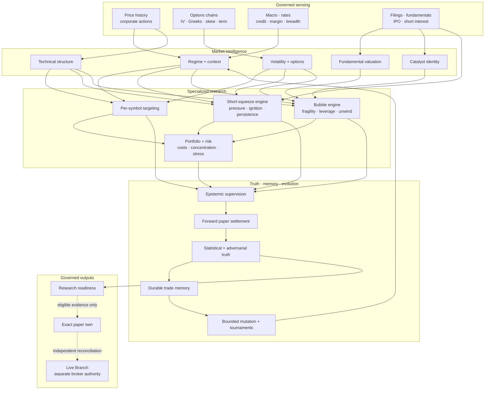

# DOPEY

<div align="center">


### Evidence-first autonomous market intelligence with a governed live boundary

**Sense → hypothesize → falsify → settle → remember → target → govern**

[](https://github.com/ObtuseAI/dopey/actions/workflows/tests.yml)


<br>


<sub>A market operating system designed to become more capable without becoming easier to fool.</sub>

[Operating model](#operating-and-learning-loop) ·
[Capabilities](#capability-map) ·
[Squeeze intelligence](#short-squeeze-intelligence) ·
[Bubble intelligence](#bubble-leverage-ipo-and-extreme-valuation-intelligence) ·
[Desktop](#native-desktop-control-center) ·
[Quick start](#quick-start)

</div>

---

DOPEY is an autonomous market-intelligence operating system for equities,
options, and macro research. It acquires governed evidence, builds per-symbol
hypotheses, attacks those hypotheses adversarially, records paper decisions
before outcomes are known, settles them without rewriting history, and permits
improvement only when measured fitness supports it.

It is ambitious about research and deliberately conservative about claims.
Backtests, replays, model prices, paper fills, and synthetic fixtures can test
mechanics; they cannot become realized or forward evidence. Missing data,
stale observations, negative-control anomalies, incomplete provenance, and
corrupt lineage fail closed.

> **Current public truth:** a fresh clone starts with no provider market data,
> credentials, broker history, account state, or private runtime lake. New
> intelligence is paper-first and reports `not_action_ready` until forward
> evidence earns a stronger state.

## What DOPEY does

| Capability | What it produces | What keeps it honest |
| --- | --- | --- |
| **Market structure** | Multi-timeframe trend, range, support/resistance, patterns, divergences, breadth, and regime context | Chronological features, point-in-time inputs, explicit contradictions |
| **Symbol research** | A joined dossier of price action, fundamentals, earnings, macro context, catalysts, liquidity, and uncertainty | Typed data gaps, freshness, and immutable source identity |
| **Short-squeeze research** | Pressure, borrow stress, settlement stress, ignition, persistence, and robustness | Open short interest stays distinct from daily short flow; pressure stays distinct from catalyst |
| **Bubble and IPO research** | Valuation and leverage fragility, IPO reflexivity, liquidity stress, and unwind confirmation | Extreme P/E or a recent IPO is never an automatic short |
| **Options research** | IV/skew/term scenarios, Greeks, contract ranking, and defined-risk paper expressions | The underlying thesis comes first; options receive no directional authority |
| **Strategy research** | Baselines, challengers, matched controls, cost stress, purged eras, and paper forecasts | Multiple-testing penalties, append-only trials, independent gates |
| **Forward learning** | Immutable predictions, later outcomes, calibration diagnostics, and abstention analysis | Event-time settlement; no replay-to-proof promotion |
| **Autonomous operations** | Dependency-aware research lanes, recovery, scheduling, and durable state | Every stage publishes its exact success, degraded, blocked, or timeout state |

## Operating and learning loop

DOPEY is organized as interacting evidence loops, not a linear
“predict and trade” script.

```mermaid
flowchart LR
    O["1. Sense<br/>market · macro · options · filings"] --> H["2. Hypothesize<br/>signals · regimes · targets"]
    H --> A["3. Falsify<br/>controls · contradictions · leakage"]
    A --> P["4. Paper test<br/>costs · risk · path · exits"]
    P --> S["5. Settle<br/>forward outcomes · calibration"]
    S --> M["6. Remember<br/>immutable lineage · trade memory"]
    M --> E["7. Evolve<br/>bounded mutations · tournaments"]
    E --> G["8. Govern<br/>fitness · readiness · rollback"]
    G --> O
    G -.->|"eligible evidence only"| T["Exact paper twin"]
    T -.->|"separate authority"| L["Live Branch"]
```



| Loop | Reads | Produces | Cannot do |
| --- | --- | --- | --- |
| Market sensing | Price history, options chains, macro, IPO, short-interest, margin, filings | Freshness-stamped, source-hashed observations | Invent missing data |
| Signal formation | Technical structure, regimes, volatility, flow, valuation, attention | Directional and neutral hypotheses with provenance | Treat confidence as truth |
| Per-symbol targeting | Settled playbooks, scanner fitness, calibrated IV, liquidity | Immutable candidate registries and paper-shadow selections | Read broker state or build orders |
| Squeeze/bubble intelligence | Short crowding, borrow, FTD, float, valuation, IPO, leverage, options pressure | Pressure, fragility, ignition, unwind, persistence, robustness | Call crowding a squeeze or valuation a short by itself |
| Epistemic attack | Claims, sources, regime cells, denominators, contribution weights | Preserve, downgrade, block, or declare inconclusive | Promote candidates or weaken gates |
| Forward settlement | Paper hypotheses and later observations | Outcomes, calibration, clustered trust, loss attribution | Rewrite old predictions |
| Memory and evolution | Settled evidence, failures, baselines, holdouts | Durable experience, bounded mutations, rollback requirements | Auto-promote on proxy fitness |
| Live boundary | Eligible action, reconciliation, buying power, exact paper twin | Queued, submitted, filled, or rejected broker evidence | Infer fills or bypass the twin |

Every stage publishes typed artifacts. A blocked stage remains blocked, and a
timeout remains `inconclusive_timeout`; downstream consumers cannot silently
replace missing evidence with a fallback claim.

## Capability map



## Intelligence built for difficult markets

### Per-symbol targeting

Every validated symbol remains represented even when evidence is
insufficient. The targeting lane combines:

- point-in-time history and liquidity;
- current-policy playbook settlements;
- deduplicated scanner fitness;
- per-symbol implied-volatility calibration;
- regime and structure context;
- source freshness, content hashes, and sample floors;
- capacity and concentration constraints.

Candidate registries are immutable generations. Stable aliases are replaced
only after their source generation is written and verified. Shadow signals
deduplicate on immutable source identity, not on mutable rankings.

No targeting module imports live positions, broker state, order constructors,
or readiness authority.

### Short-squeeze intelligence

DOPEY separates **overshorted pressure** from **independent ignition**.

| Layer | Evidence |
| --- | --- |
| Pressure | Actual open short interest, short percentage of float, days to cover, two-period growth, float scarcity |
| Borrow | Fee, utilization, availability scarcity, source freshness |
| Settlement stress | Consecutive fails-to-deliver stress and official threshold-list evidence |
| Flow | Persistent daily short-sale flow, float turnover, signed volume |
| Options | Call turnover, call pressure, implied volatility, gamma |
| Ignition | 5-day/20-day returns, breakout structure, volume expansion, RSI |
| Durability | Multi-session persistence, multi-horizon confirmation, source diversity |
| Robustness | Contradiction penalties, missing-source penalties, outlier controls |

Daily short-sale volume is flow, never a substitute for open short interest.
Crowding and negative gamma remain non-directional until price behavior
provides an independent catalyst. Sparse, stale, future-dated, contradictory,
or weakly sourced evidence cannot qualify.

### Bubble, leverage, IPO, and extreme-valuation intelligence

Bubble research distinguishes an expensive or reflexive asset from a
confirmed unwind. Fragility can include:

- trailing and forward P/E;
- price-to-sales, price-to-book, and enterprise-value-to-revenue;
- valuation breadth relative to relevant history and peers;
- negative free cash flow, cash burn, debt, and net leverage;
- market-wide margin-debit pressure;
- IPO age, offer-price appreciation, deal size, float constraints, lock-up,
  and overhang context;
- extension, acceleration, attention, options crowding, IV, gamma, and
  liquidity reflexivity.

A bearish hypothesis still requires separate downside confirmation: negative
returns, moving-average breaks, breakdown structure, confirming volume, put
pressure, negative gamma, or a measured liquidity air pocket.

A recent IPO or extreme P/E is never an automatic short. Blank-check,
acquisition, fund, unit, warrant, and rights offerings are excluded from the
operating-company IPO lane.

Research expressions remain loss-limited. A qualified unwind may propose a
long put or bear-put debit spread for later governed review; it cannot produce
a naked short or undefined-loss position.

### Observable liquidity, not imaginary omniscience

DOPEY combines borrow scarcity, float turnover, daily short flow, options
turnover, quote-derived gamma, and signed volume as explicit liquidity-stress
proxies.

`direct_hidden_liquidity_observed=false`

Without licensed order-book, securities-lending, or participant-level data,
the system does not claim to see hidden intent, dealer inventory, or a
consolidated order book.

## Durable data and trade memory

DOPEY treats data durability as part of model quality:

- atomic fsync-and-replace publication for critical JSON artifacts;
- manifest containment that rejects absolute paths and parent traversal;
- exchange-calendar-aware gap validation;
- finite, positive, nonnegative-volume, and OHLC-consistency checks against
  active-lake bytes;
- immutable targeting-registry and trade-memory generations;
- hash-validated active pointers and rebuildable SQLite projections;
- append-only histories for attempts, findings, signals, settlements,
  incidents, mutations, and live outcomes.

Trade-memory outcomes use fractional model-return units and validate premium
and P&L accounting identity. Row fanout and unique economic trades are
reported separately, preventing repeated family views from masquerading as
independent experience.

## Resilient autonomy

The 39-stage supervisor is dependency-aware and
**absorb → record → continue**: one failed independent research stage does
not erase the rest of the run.

It records stage dependencies, early exits, degraded states, start/end
identity, heartbeats, timeouts, process-tree termination, recovery
tombstones, disk pressure, repair debt, and exact run identity. Dependent work
is skipped with its causal blocker preserved.

A transactional `SystemSnapshot` binds source and projection hashes before
cross-system decisions. Scheduling can prioritize stale or never-successful
research, but it cannot lower evidence floors, rewrite safety law, grant
broker authority, or silently enable options.

Autonomy here means **durable evidence production and truthful abstention**,
not unrestricted self-modification.

## Evidence truth

DOPEY is designed to reject attractive false positives:

1. **No simulation laundering.** Historical replay and synthetic data never count as forward proof.
2. **No silent mutation.** Predictions and failures remain append-only; repaired candidates become new versions.
3. **No self-grading.** Candidate authors cannot promote their own work.
4. **No midpoint fiction.** Observed midpoint, model value, and conservative paper-executable price stay distinct.
5. **No complexity bonus.** A sophisticated model must beat strong simple baselines after costs.
6. **No missing-data optimism.** Stale, crossed, future-dated, or incomplete evidence forces abstention.
7. **No duplicate evidence.** Co-fired detectors and overlapping windows cannot masquerade as independent trials.
8. **No authority creep.** Automated research can tighten risk; it cannot loosen gates or unlock execution.

Backtests, replay, model prices, shadow signals, paper fills, submitted orders,
broker fills, and realized P&L remain distinct evidence classes.

## Governed research and live authority

DOPEY has two deliberately separate planes.

| Plane | Purpose | Authority |
| --- | --- | --- |
| Research plane | Observe, model, rank, falsify, simulate, settle, and learn | Paper-first for new intelligence; no order construction |
| Live Branch | Reconcile the dedicated account, stage exact paper twins, review eligible actions, and record broker results | Sole broker-capable package under `dopey_live/` |

- `dopey_live/` is the only broker-capable package.
- Every eligible live decision must stage an exact paper twin before broker
  review.
- Long-premium and defined-risk option execution is implemented but remains
  owner-disabled.
- Targeting, squeeze, bubble, mutation, and epistemic surfaces remain
  `paper_only`, `live_blocked`, and not action ready.
- Missing authentication, provenance, freshness, identity, buying power,
  reconciliation, or ledger integrity fails closed without an order.

Read the authority contract in
[`DOPEY_CONSTITUTION.md`](DOPEY_CONSTITUTION.md).

## Native desktop control center


<sub>Source-backed 1540 × 960 capture from DOPEY's deterministic, read-only
visual-QA surface. Broker identifiers are redacted and the capture bridge has
no mutation authority.</sub>

The React 19 desktop makes the research organism inspectable through
evidence-bound workspaces:

| Market Tissue | Symbol Lab |
| --- | --- |
|  |  |
| Universe coverage, four-tail discovery, source integrity, and regime dimensions | Per-symbol structure, scenario repricing, contract ranking, and defined-risk research |

Every quantitative surface has a table, provenance view, and method
explanation. Unavailable telemetry remains unavailable; the interface does
not animate or chart fictional data.

## Repository map

```text
dopey/                    protected law, truth, strategy, settlement, and memory
dopey_data/               governed history, manifests, validation, and publication
dopey_analysis/           signals, indicators, structure, regime, and context
dopey_options/            chains, Greeks, IV, skew, term, and lifecycle research
dopey_targeting/          gate-blind per-symbol ranking and paper-shadow selection
dopey_squeeze_bubble/     squeeze pressure, bubble fragility, IPO, and unwind research
dopey_validation/         statistical, adversarial, epistemic, and preflight validation
dopey_autonomy/           dependency-aware 39-stage research supervisor
dopey_acceleration/       bounded scheduling, snapshots, reliability, and capabilities
dopey_fitness/            truth-gated diagnostic fitness and promotion quarantine
dopey_audit/              evidence inventory, replay proof, and mutation ledger
dopey_backtest/           honest backtests, walk-forward, costs, and veto-shadow evidence
dopey_risk_engine/        entry guards, exposures, stress ladders, and kill switches
dopey_live/               sole broker-capable package and exact paper-twin boundary
desktop/                  React 19 operator command center
operator_tools/           bounded operator entry points and Windows scheduling
verifier/                 protected manifests and release verification
tests/                    integration, safety, evidence, and release validation
```

## Quick start

DOPEY is developed and operated on Windows with PowerShell.

### Public data boundary

A fresh public clone starts with **no provider market data, broker exports,
credentials, account history, private runtime lake, or private session
reports**. It includes source code, schemas, deterministic synthetic/test
fixtures, and one hash-pinned, test-only archive of derived paper-research
outputs. That archive contains no raw provider dataset, broker history,
current state, or forward evidence and is extracted only into isolated test
directories.

Operators bring their own licensed data through governed local staging. Those
paths are ignored by Git and fail closed when missing.

Read [`DATA_NOTICE.md`](DATA_NOTICE.md) and the machine-readable
[`PUBLIC_SOURCE_MANIFEST.json`](PUBLIC_SOURCE_MANIFEST.json) before staging
data.

```powershell
git clone https://github.com/ObtuseAI/dopey.git
cd dopey

py -3.11 -m venv .venv
.venv\Scripts\python.exe -m pip install --upgrade pip
.venv\Scripts\python.exe -m pip install -e ".[dev,desktop]"
```

Validate the checkout:

```powershell
.venv\Scripts\python.exe -m ruff check .
.venv\Scripts\python.exe -m pytest --collect-only -q
.venv\Scripts\python.exe -m pip check
```

Run bounded research surfaces:

```powershell
# Missing or stale governed inputs produce typed blocked states.
.venv\Scripts\python.exe -m dopey_targeting.runtime
.venv\Scripts\python.exe -m dopey_squeeze_bubble.runtime
.venv\Scripts\python.exe -m dopey_autonomy.run_resilient_research_supervisor
```

Build the desktop command center:

```powershell
cd desktop
npm.cmd ci
npm.cmd run typecheck
npm.cmd run build
.\launch_desktop.ps1
```

Repository commands never configure broker credentials, scrape tokens, or
silently arm live execution.

## Public validation state

| Validation | Result |
| --- | ---: |
| Public clean-slate operational gate | 1,242 passed / 3 skipped |
| Public source secret scan | 0 Gitleaks findings |
| Public data boundary | 0 provider-history, market-lake, broker-history, or credential files |
| Deterministic CI gate | 1,245 / 1,245 passed |
| CI shard 1 | 332 passed |
| CI shard 2 | 272 passed |
| CI shard 3 | 305 passed |
| CI shard 4 | 336 passed |
| Repository collection | 4,334 collected / 0 collection errors |
| Focused supervisor and epistemic integration | 31 passed |
| Dependency integrity | Passed |
| Protected/live-path release diff | Empty |

A repository-wide 4,332-test run reached its 15-minute boundary without a
captured failure and remains `inconclusive_timeout`, not pass. The current
4,334-test collection includes two subsequent regression tests; both passed
in focused and affected-shard reruns.

The v2 squeeze/bubble and epistemic engines are implementation,
adversarial-test, and CI-gate proven. They have not been represented as a new
production outcome run or end-to-end 39-stage soak.

## Current honest blockers

1. Current-policy detections must settle before targeting can earn verified
   candidates.
2. Research readiness remains below its 100-close and 200-decision evidence
   floors.
3. No playbook family has 30 independent effective contested clusters.
4. Squeeze and bubble forward evidence remains insufficient for action
   candidates.
5. Licensed securities-lending, richer FTD/threshold coverage, and direct
   microstructure feeds remain evidence gaps.
6. Options execution remains owner-disabled.

## What DOPEY refuses to do

> Fabricate market evidence. Relabel replay as realized performance. Treat a
> timeout as a pass. Hide a losing trial. Count duplicates as independent
> evidence. Substitute daily short flow for open short interest. Treat a high
> P/E or recent IPO as an automatic short. Claim hidden intent from proxies.
> Let a model weaken a gate. Store broker credentials. Call a queued order
> filled. Enable options silently. Claim profitability before forward evidence
> earns it.

## Documentation

- [Epistemic hardening and market intelligence](docs/reports/DOPEY_EPISTEMIC_HARDENING_AND_MARKET_INTELLIGENCE_2026-07-26.md)
- [Durability, resilience, and intelligence review](docs/reports/DOPEY_DURABILITY_INTELLIGENCE_IMPLEMENTATION_2026-07-26.md)
- [Squeeze and bubble intelligence](reports/DOPEY_SQUEEZE_BUBBLE_INTELLIGENCE_20260725.md)
- [Full audit remediation](docs/reports/DOPEY_FULL_AUDIT_REMEDIATION_20260725.md)
- [Data notice](DATA_NOTICE.md)
- [Security policy](SECURITY.md)
- [Contributing](CONTRIBUTING.md)
- [Public source manifest](PUBLIC_SOURCE_MANIFEST.json)

## Data, license, and risk

Code is MIT-licensed. Market-data rights remain with their providers. DOPEY is
experimental financial software, not investment advice or a promise of
returns. Options can lose the full premium paid. Live authority does not imply
model quality; operators remain responsible for independently validating the
software, evidence, and risk controls.

<div align="center">

### Accuracy before confidence. Evidence before promotion. Survival before scale.

</div>
