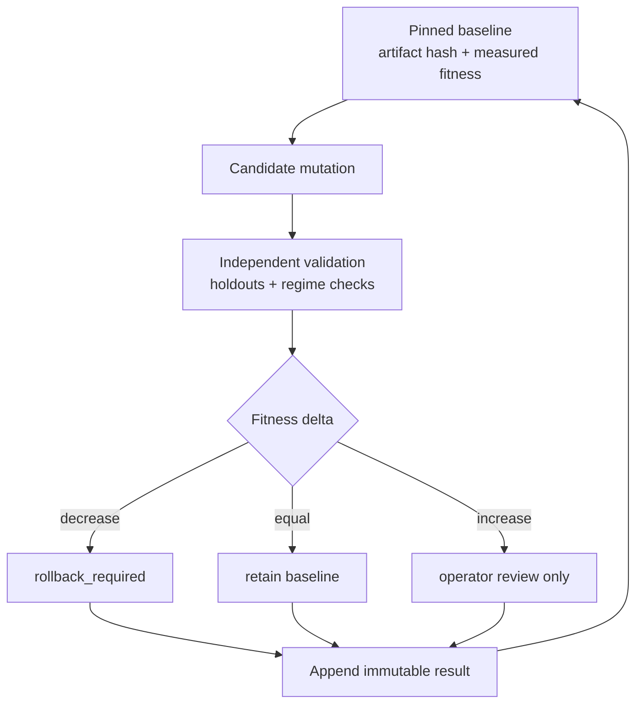
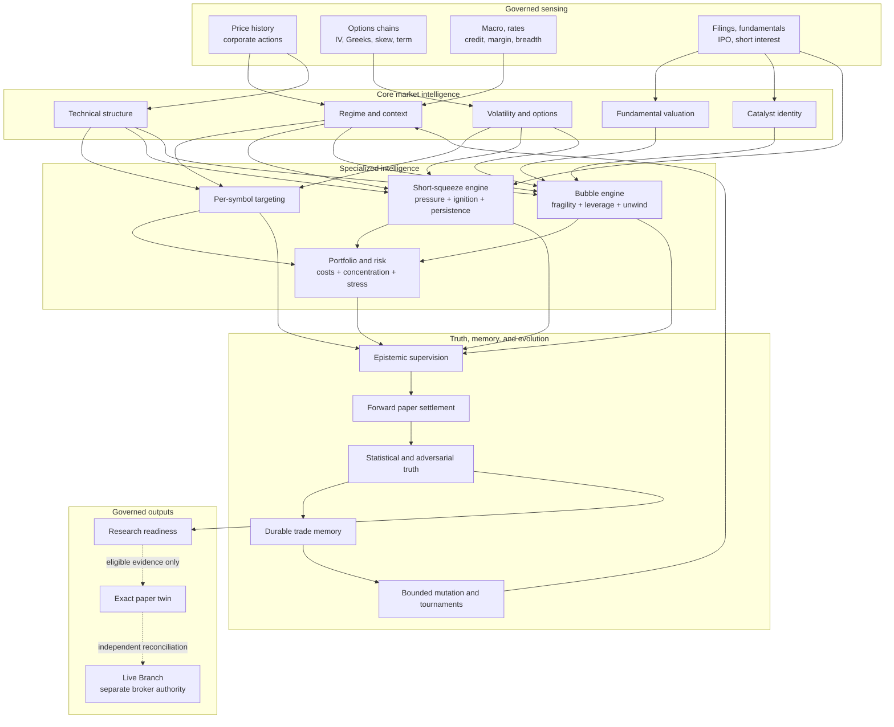
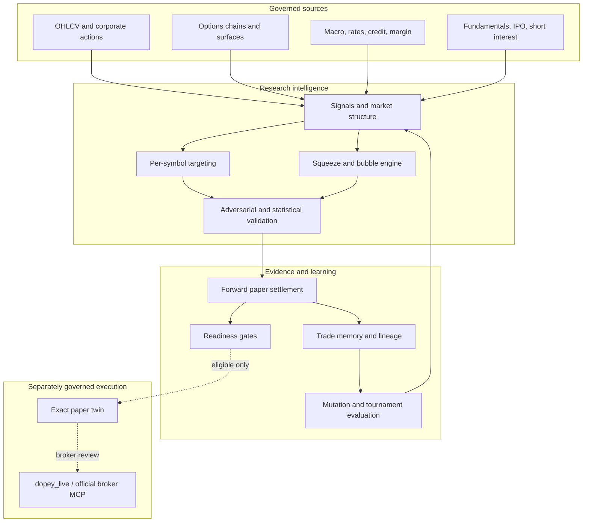

# DOPEY

<div align="center">


## Evidence-first autonomous market intelligence

**Observe the market. Challenge every claim. Learn only from settled evidence.**

`SENSE -> MODEL -> TARGET -> ATTACK -> SETTLE -> REMEMBER -> IMPROVE -> GOVERN`

[](https://github.com/ObtuseAI/dopey/actions/workflows/tests.yml)


<sub>Source-backed 1540 x 960 read-only visual-QA capture. Broker identifiers are redacted and the capture bridge has no mutation authority.</sub>

### A market operating system designed to become more capable without becoming easier to fool

[Operating model](#the-operating-model) ·
[Loop diagram](#operating-and-learning-loop-diagram) ·
[Capability diagram](#capability-topology-diagram) ·
[Architecture](#system-architecture) ·
[Evidence](#epistemic-honesty) ·
[Quick start](#quick-start) ·
[Validation](#validation-state)

</div>

---

## What DOPEY is

DOPEY is a system of systems for equities, options, and macro research. It
acquires governed evidence, builds per-symbol hypotheses, attacks those
hypotheses adversarially, settles predictions against later observations,
stores the resulting memory, and uses measured outcomes to improve future
research.

It is not a single model, scanner, strategy, or prompt loop. It is a durable
operating architecture with:

- a point-in-time market-data spine;
- multi-horizon technical, structural, fundamental, macro, and options
  intelligence;
- per-symbol targeting and specialized squeeze/bubble research;
- forward paper settlement and clustered statistical validation;
- downgrade-only epistemic supervision;
- immutable evidence, lineage, decision, incident, and mutation ledgers;
- a dependency-aware 39-stage research supervisor;
- a separately controlled Live Branch with exact paper twins.

The central design rule is simple:

> No claim becomes stronger merely because the system repeated it, renamed it,
> scored it confidently, or wanted it to be true.

## The operating model

DOPEY has two deliberately separate planes.

| Plane | Purpose | Authority |
| --- | --- | --- |
| Research plane | Observe, model, rank, falsify, simulate, settle, and learn | Paper-only for new intelligence; no order construction |
| Live Branch | Reconcile the dedicated account, stage exact paper twins, review eligible actions, and record broker results | Sole broker-capable package under `dopey_live/` |

The constitutional operating mode is `LIVE`. That does **not** mean every
research output is executable.

- `dopey_live/` is the only broker-capable package.
- Eligible long-equity actions use the official Robinhood Trading MCP.
- Every live decision must stage an exact paper twin before broker review.
- Long-premium and defined-risk option execution is implemented but remains
  owner-disabled.
- New targeting, squeeze, bubble, mutation, and epistemic surfaces are
  `paper_only`, `live_blocked`, and not action ready.
- Missing authentication, provenance, freshness, identity, buying power,
  reconciliation, or ledger integrity fails closed without an order.

The authority contract lives in
[`DOPEY_CONSTITUTION.md`](DOPEY_CONSTITUTION.md).

---

## Continuous workflow loops

DOPEY is organized as interacting evidence loops rather than a linear
"predict and trade" script.

### Operating and learning loop diagram


### Loop map

| Loop | Reads | Produces | Cannot do |
| --- | --- | --- | --- |
| Market sensing | Price history, options chains, macro, IPO, short-interest, margin, filings | Freshness-stamped and source-hashed observations | Invent missing data |
| Signal formation | Technical structure, regimes, volatility, flow, valuation, attention | Directional and neutral hypotheses with explicit provenance | Treat confidence as truth |
| Per-symbol targeting | Settled playbook evidence, scanner fitness, calibrated IV, liquidity | Immutable candidate registries and paper-shadow selections | Read live positions or readiness gates |
| Squeeze/bubble intelligence | Short crowding, borrow, FTD, float, valuation, IPO, leverage, options pressure | Pressure, fragility, ignition, unwind, persistence, and robustness assessments | Call crowding a squeeze or valuation a short by itself |
| Epistemic attack | Claims, sources, regime cells, denominators, contribution weights | Preserve, downgrade, block, or declare inconclusive | Promote candidates or build orders |
| Forward settlement | Paper hypotheses and later market observations | Outcome labels, calibration, clustered trust, loss attribution | Rewrite old predictions after outcomes arrive |
| Memory | Signals, entries, exits, paths, costs, regimes, failures | Content-addressed generations, graph relations, SQLite projections | Count duplicate views as independent trades |
| Evolution | Baselines, candidates, holdouts, settled fitness | Mutation lineage, tournament results, rollback requirements | Auto-promote on proxy or deteriorating fitness |
| Readiness | Independent evidence floors and reconciliation state | Exact `action_ready` or blocked status | Convert infrastructure activity into readiness |
| Live execution | Eligible action, broker state, buying power, paper twin | Queued/submitted/filled/rejected broker evidence | Infer fills, bypass the twin, or perform same-session round trips |

### Daily research loop

```text
Freshness and integrity
  -> market and macro context
  -> signals, structure, volatility, and valuation
  -> per-symbol targeting
  -> squeeze/bubble specialization
  -> epistemic challenge
  -> forward paper walk
  -> settlement, trust, and calibration
  -> trade memory
  -> bounded scheduling and next-cycle priorities
```

Each stage publishes typed artifacts. A blocked stage remains visible as
blocked; a timeout remains `inconclusive_timeout`; a downstream consumer
cannot silently replace missing evidence with a fallback claim.

### Learning and mutation loop



Mutation history is append-only and hash-chained. The separate head anchor
detects valid-prefix truncation. Corruption blocks future appends; the system
does not silently repair or reforge its own history.

### Resilience loop

The supervisor uses absorb-record-continue behavior for independent research
lanes. It records stage dependencies, start/end state, heartbeats, timeouts,
process-tree termination, recovery tombstones, disk pressure, repair debt,
and exact run identity. Independent work continues when safe; dependent work
is skipped with its causal blocker preserved.

---

## Intelligence capabilities

### Capability topology diagram



### Capability matrix

| Intelligence family | What DOPEY measures | Output |
| --- | --- | --- |
| Market regime | Breadth, trend, volatility, correlation, liquidity, credit, rates, inflation, dollar, crowding | Point-in-time regime context |
| Technical structure | Multi-horizon returns, trends, breakouts, breakdowns, support/resistance, RSI, momentum, volume | Directional and neutral hypotheses |
| Statistical truth | Drift-aware baselines, event deduplication, eras, holdouts, clustered samples, deflation | Evidence-strength and fitness verdicts |
| Options | Chains, Greeks, IV, skew, term structure, gamma, spread quality, lifecycle, model repricing | Research expressions and calibrated risk |
| Fundamental/valuation | Earnings multiples, sales/book/revenue multiples, cash burn, leverage, peer/lifecycle context | Fragility and valuation context |
| IPO/reflexivity | Listing age, offer appreciation, deal size, float constraints, lock-up and overhang context | Staged IPO fragility evidence |
| Short pressure | Open short interest, float percentage, days to cover, growth, borrow scarcity, FTD stress, threshold evidence | Crowding and persistence assessment |
| Liquidity stress | Dollar/float turnover, signed volume, short flow, options turnover, gamma, borrow availability | Explicit proxy score, never hidden-intent proof |
| Catalysts/context | Filings, earnings, revisions, corporate actions, macro and news availability | Source-timed catalyst identity |
| Portfolio/risk | Exposure, concentration, liquidity, Greeks, path loss, stress ladders, kill switches | Loss-limited paper allocation |
| Trade memory | Entry/exit, path, regime, costs, P&L identity, family and cohort lineage | Reusable conditional experience |
| Adversarial intelligence | Contradictions, duplication, leakage, outliers, regime inversion, contamination | Downgrade/block/inconclusive decisions |

### Per-symbol intelligence

Every validated symbol remains represented even when evidence is insufficient.
The targeting lane combines:

- point-in-time history and liquidity;
- current-policy playbook settlements;
- deduplicated scanner fitness;
- per-symbol implied-volatility calibration;
- regime and structure context;
- source freshness, content hashes, and sample floors;
- capacity and concentration constraints.

Candidate registries are immutable generations. Stable aliases are replaced
only after their source generation is written and verified. Shadow signals
deduplicate on immutable source identity, not on mutable rankings.

No targeting module imports live positions, broker state, order constructors,
or readiness authority.

### Short-squeeze intelligence

DOPEY separates **crowding pressure** from **independent ignition**.

| Layer | Evidence |
| --- | --- |
| Pressure | Actual open short interest, short percentage of float, days to cover, two-period growth, float scarcity |
| Borrow | Fee, utilization, availability scarcity, source freshness |
| Settlement stress | Consecutive fails-to-deliver stress and official threshold-list evidence |
| Flow | Persistent daily short-sale flow, float turnover, signed volume |
| Options | Call turnover, call pressure, implied volatility, gamma |
| Ignition | 5-day/20-day returns, breakout structure, volume expansion, RSI |
| Durability | Multi-session persistence, multi-horizon confirmation, source diversity |
| Robustness | Contradiction penalties, missing-source penalties, outlier controls |

Daily short-sale volume is flow, never a substitute for open short interest.
Crowding and negative gamma remain non-directional until price behavior
provides an independent catalyst. Sparse, stale, future-dated, contradictory,
or weakly sourced evidence cannot qualify.

### Bubble, leverage, IPO, and extreme-valuation intelligence

DOPEY also separates **fragility** from **unwind confirmation**.

Fragility can include:

- trailing and forward P/E;
- price-to-sales and price-to-book;
- enterprise-value-to-revenue;
- valuation breadth relative to relevant history and peers;
- negative free cash flow and cash burn;
- debt, net leverage, and market-wide margin-debit pressure;
- IPO age, offer-price appreciation, deal size, float constraints, and
  potential overhang;
- price extension, acceleration, attention, options crowding, IV, and gamma.

An unwind candidate still requires independent downside evidence: negative
returns, moving-average breaks, breakdown structure, confirming volume, put
pressure, negative gamma, or a measured liquidity air pocket.

A recent IPO or extreme P/E is never an automatic short. Blank-check,
acquisition, fund, unit, warrant, and rights offerings are excluded from the
operating-company IPO lane.

Research expressions remain loss-limited. A qualified unwind may propose a
long put or bear-put debit spread for later governed review; it cannot produce
a naked short or undefined-loss position.

### Observable liquidity, not imaginary omniscience

DOPEY can observe and combine borrow scarcity, float turnover, short flow,
options turnover, quote-derived gamma, and signed volume. It labels these as
liquidity-stress proxies.

`direct_hidden_liquidity_observed=false`

Without licensed order-book, securities-lending, or participant-level data,
the system does not claim to see hidden intent, dealer inventory, or a
consolidated order book.

---

## Epistemic honesty

Every targeting and squeeze/bubble claim passes through an independent,
downgrade-only epistemic stage.

| Adversarial test | Failure caught |
| --- | --- |
| Point-in-time validation | Stale evidence, future leakage, prior-run reuse |
| Canonical fingerprints | Duplicate sources, relabeling, contribution reuse |
| Contradiction analysis | Conflicting directions within an evidence family |
| Denominator requirements | Rates and effects without enough observations |
| Contribution limits | One source or outlier dominating the conclusion |
| Regime decomposition | Simpson effects and direction reversal across regimes |
| Catalyst independence | Crowding presented as its own catalyst |
| IPO mechanics | Limited-float reflexivity presented as durable skill |
| Peer identity | Sector- or lifecycle-mismatched valuation comparisons |
| Layer isolation | Research claims contaminated by broker/order/live inputs |
| Fitness provenance | Holdout reuse, parent mismatch, proxy promotion, fitness laundering |
| Status preservation | Blocked, missing, invalid, timeout, and inconclusive states being upgraded |

The stage can preserve a claim, downgrade it, block it, or mark it
inconclusive. It cannot promote, allocate capital, construct an order, or
change a readiness gate.

### Evidence classes never collapse

```text
historical observation
!= backtest result
!= replay result
!= model-priced option
!= paper signal
!= paper fill
!= submitted order
!= broker fill
!= realized P&L
```

DOPEY keeps these classes separate across schemas, reports, dashboards, and
ledgers. Confidence is metadata; settlement is evidence.

---

## The 39-stage supervisor

The research supervisor is a typed dependency graph grouped into seven
functional bands.

| Band | Stages |
| --- | --- |
| Integrity and context | Data freshness, envelope integrity, macro context, history validation |
| Signals and truth | Real signals, market structure, IV calibration, backtest, baseline arbitration, era walk-forward, statistical truth, truth-gated fitness |
| Options and fusion | Chain analytics, volatility surface, market-context fusion, straddle VRP probe |
| Forward evidence | Forward paper walk, forecast card, book quality, book risk, signal calibration |
| Adversarial learning | Adversarial stress, distributional stress, kaizen ledger, exit playbook, playbook research |
| Specialized intelligence | Symbol targeting, squeeze/bubble intelligence, epistemic supervision, adversarial panel, loss coach, target screener, universe governor, exit-policy search, chart vision, indicator foundry |
| Independent governance roots | Reliability SLO, Agentic-account reconciliation, action-readiness gate |

`symbol_targeting` and `squeeze_bubble_intelligence` are hard producers for
`epistemic_supervision`. Account reconciliation and action readiness remain
independent roots so research cannot manufacture execution authority through
dependency pressure.

---

## System architecture



### Durable state model

- Critical JSON publications use atomic fsync-and-replace.
- Manifests reject absolute paths, parent traversal, and containment escapes.
- Market-history validation checks exchange sessions, finite values, positive
  prices, nonnegative volume, and OHLC consistency against active bytes.
- Candidate, memory, ledger, and mutation generations are content-addressed.
- SQLite is a rebuildable projection; immutable source generations remain
  authoritative.
- Attempts, failures, rejected mutations, incidents, and live-order states are
  append-only.
- Queued, submitted, partially filled, filled, rejected, and reconciled are
  distinct states.

---

## Current evidence state

This is a source-release engineering and evidence snapshot, not a performance
claim. The underlying provider datasets and private runtime history are not
included in the public repository.

| Surface | Latest recorded state | Interpretation |
| --- | ---: | --- |
| Validated history spine | 225 symbols / 1,808,325 bars | Broad local coverage; not proof of edge |
| Per-symbol targeting | 225 candidates / 0 verified | Current-policy settlements have not matured |
| Current-policy playbook | 572 detections / 0 duplicate appends on rerun | Fresh hypotheses, unresolved outcomes |
| Prior squeeze/bubble scan | 162 squeeze watches / 53 bubble watches | Zero action candidates in that snapshot |
| Scanner fitness v5 | 8,015 unique symbol-date events | Deduplicated mean excess over drift: -0.001436 |
| Playbook trust v4 | 0 rated families | No family meets the independent-cluster floor |
| Trade memory v3 | 321,768 rows / 186,640 unique economic trades | Durable conditional memory, not forward performance |
| Research readiness | 13 / 100 validated closes; 1 / 200 resolved decisions | `not_action_ready` |

The v2 squeeze/bubble and epistemic engines in this release are implementation,
adversarial-test, and CI-gate proven. They have not been represented as a new
production outcome run or end-to-end 39-stage soak.

### Current blocking evidence

1. Current-policy detections must settle before targeting can earn verified
   candidates.
2. Research readiness remains below its 100-close and 200-decision floors.
3. No playbook family has 30 independent effective contested clusters.
4. Squeeze and bubble forward evidence remains insufficient for action
   candidates.
5. Licensed securities-lending, richer FTD/threshold coverage, and direct
   microstructure feeds remain evidence gaps.
6. Options execution remains owner-disabled.

---

## Desktop command center

The React 19 desktop application exposes evidence and control state without
turning the UI into a second source of truth.

| Market Tissue | Symbol Lab |
| --- | --- |
|  |  |
| Universe coverage, four-tail discovery, source integrity, and regime dimensions | Per-symbol structure, scenario repricing, contract ranking, and defined-risk research |

The screenshots are deterministic visual fixtures. Model values are labeled
as model values, execution remains sealed in the capture bridge, and the UI
cannot mutate broker or research authority.

---

## Repository map

```text
dopey/                    protected law, truth, strategy, settlement, and memory
dopey_data/               governed history, manifests, validation, and publication
dopey_analysis/           signals, indicators, structure, regime, and context
dopey_options/            chains, Greeks, IV, skew, term, and lifecycle research
dopey_targeting/          gate-blind per-symbol ranking and paper-shadow selection
dopey_squeeze_bubble/     squeeze pressure, bubble fragility, IPO, and unwind research
dopey_validation/         statistical, adversarial, epistemic, and preflight validation
dopey_autonomy/           dependency-aware 39-stage research supervisor
dopey_acceleration/       bounded scheduling, snapshots, reliability, and capabilities
dopey_fitness/            truth-gated diagnostic fitness and promotion quarantine
dopey_audit/              evidence inventory, replay proof, and mutation ledger
dopey_backtest/           honest backtests, walk-forward, costs, and veto-shadow evidence
dopey_risk_engine/        entry guards, exposures, stress ladders, and kill switches
dopey_live/               sole broker-capable package and exact paper-twin boundary
desktop/                  React 19 operator command center
operator_tools/           bounded operator entry points and Windows scheduling
verifier/                 protected manifests and release verification
tests/                    integration, safety, evidence, and release validation
```

---

## Quick start

DOPEY is developed and operated on Windows with PowerShell.

### Public data boundary

A fresh public clone starts with **no provider market data, broker exports,
credentials, account history, or private runtime lake**. It includes only
source code, schemas, and deterministic synthetic/test fixtures. Operators
bring their own licensed data through governed local staging; those paths are
ignored by Git and fail closed when missing.

Read [`DATA_NOTICE.md`](DATA_NOTICE.md) and the machine-readable
[`PUBLIC_SOURCE_MANIFEST.json`](PUBLIC_SOURCE_MANIFEST.json) before staging
data.

```powershell
git clone https://github.com/ObtuseAI/dopey.git
cd dopey

py -3.11 -m venv .venv
.venv\Scripts\python.exe -m pip install --upgrade pip
.venv\Scripts\python.exe -m pip install -e ".[dev,desktop]"
```

### Validate the checkout

```powershell
.venv\Scripts\python.exe -m ruff check .
.venv\Scripts\python.exe -m pytest --collect-only -q
.venv\Scripts\python.exe -m pip check
```

The complete test suite is intentionally large. CI uses deterministic
content-addressed shards:

```powershell
.venv\Scripts\python.exe -m operator_tools.ci_shards plan `
  --repository-root . `
  --manifest .github\ci\fast_subset.txt `
  --shards 4 `
  --output .tmp\ci-shard-plan.json
```

### Run bounded research surfaces

```powershell
# Missing or stale governed inputs produce typed blocked states.
.venv\Scripts\python.exe -m dopey_targeting.runtime
.venv\Scripts\python.exe -m dopey_squeeze_bubble.runtime
.venv\Scripts\python.exe -m dopey_autonomy.run_resilient_research_supervisor
```

### Build the desktop

```powershell
cd desktop
npm.cmd ci
npm.cmd run typecheck
npm.cmd run build
.\launch_desktop.ps1
```

Repository commands never configure broker credentials, scrape tokens, or
silently arm live execution.

---

## Validation state

| Validation | Result |
| --- | ---: |
| Public clean-slate operational gate | 1,242 passed / 3 skipped |
| Public source secret scan | 0 Gitleaks findings |
| Public data boundary | 0 provider-history, market-lake, broker-history, or credential files |
| Deterministic CI gate | 1,245 / 1,245 passed |
| CI shard 1 | 332 passed |
| CI shard 2 | 272 passed |
| CI shard 3 | 305 passed |
| CI shard 4 | 336 passed |
| Repository collection | 4,334 collected / 0 collection errors |
| Final focused supervisor and epistemic integration | 31 passed |
| Ruff on changed Python surfaces | Passed |
| Python compilation | Passed |
| Dependency integrity | Passed |
| Workflow YAML and Bash syntax | Passed |
| Protected/live-path diff | Empty |

A repository-wide 4,332-test run reached its 15-minute boundary without a
captured failure and remains `inconclusive_timeout`, not pass. The current
4,334-test collection includes two subsequent regression tests; both passed
in focused and affected-shard reruns.

CI assigns each test file with `SHA-256(test path) mod 4`. Manifest reordering
or incremental additions cannot move existing files between shards. Every
assigned file must collect at least one node, node IDs must be globally
unique, and the worktree must be identical before and after each shard.

---

## What DOPEY refuses to do

> Fabricate market evidence. Relabel replay as realized performance. Treat a
> timeout as a pass. Hide a losing trial. Count duplicates as independent
> evidence. Substitute daily short flow for open short interest. Treat a high
> P/E or recent IPO as an automatic short. Claim hidden intent from proxies.
> Let a model weaken a gate. Store broker credentials. Call a queued order
> filled. Enable options silently. Claim profitability before forward
> evidence earns it.

## Documentation

- [Epistemic hardening and market intelligence](docs/reports/DOPEY_EPISTEMIC_HARDENING_AND_MARKET_INTELLIGENCE_2026-07-26.md)
- [Durability, resilience, and intelligence review](docs/reports/DOPEY_DURABILITY_INTELLIGENCE_IMPLEMENTATION_2026-07-26.md)
- [Squeeze and bubble intelligence](reports/DOPEY_SQUEEZE_BUBBLE_INTELLIGENCE_20260725.md)
- [Full audit remediation](docs/reports/DOPEY_FULL_AUDIT_REMEDIATION_20260725.md)
- [Data notice](DATA_NOTICE.md)
- [Security policy](SECURITY.md)
- [Contributing](CONTRIBUTING.md)
- [Public source manifest](PUBLIC_SOURCE_MANIFEST.json)

## License and risk

Code is MIT-licensed. Market-data rights remain with their providers. DOPEY
is experimental financial software, not investment advice or a promise of
returns. Options can lose the full premium paid. Live authority does not
imply model quality; operators remain responsible for independently
validating evidence, software, and risk controls.

<div align="center">

### Accuracy before confidence. Evidence before promotion. Survival before scale.

</div>
