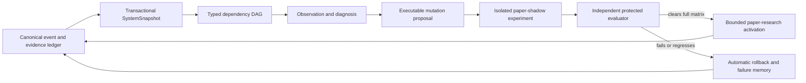

# DOPEY Autonomy, RSI, Intelligence, Cohesion, and Dynamicness Review

Date: 2026-07-25 CT
Repository: public DOPEY source tree
Reviewed branch: `agent/dopey-vnext-operational-readiness`
Reviewed commit: `a5827183c23308d96bf4f8d26d1d501640b06cc9`

## Executive conclusion

DOPEY already has the foundations of a serious evidence-first autonomous research OS:

- explicit truth and promotion gates;
- content-addressed artifacts and append-only ledgers;
- a broad 29-lane scheduler;
- state-change-triggered multi-model analysis;
- bounded paper-research promotion;
- honest `not_action_ready`, timeout, missing-data, and no-activation states.

The main limitation is not missing breadth. It is incomplete learning-loop closure.

The system can observe, schedule, hypothesize, evaluate, quarantine, and report. It does
not yet reliably convert a successful or failed experiment into a causally distinct next
generation, independently evaluate that generation, activate it in paper research, and
roll it back from measured evidence.

The highest-value improvement is therefore an **Autonomy Liveness and Causal Mutation
vertical slice**, not another strategy family, agent role, dashboard panel, or model.

## Current evidence snapshot

| Surface | Current state |
|---|---|
| Research readiness | `not_action_ready` |
| Research constitution | `paper_only=true`, `live_blocked=true` in the reviewed control plane |
| Resolved context outcomes | 1 of 200 required |
| Recorded context decisions | 6, with 5 pending maturity or settlement |
| Forward-closed trades | 13 of 100 required |
| Cohort/regime proof | No cohort beats its matched baseline familywise; no regime-robust cohort |
| Compounding | Blocked; geometric mean trade return `-0.17816026`, maximum observed drawdown `0.93792449` |
| Intelligence discovery | Generation 44; 16 hypotheses and 16 experiments queued |
| Cognitive activation | 0 activated methods, 0 theory candidates, 0 cognitive genomes |
| Independent cognitive tasks | 0; evaluator independence not verified |
| Autoresearch | Generation 54 currently blocked |
| Scheduled lane health | 25 completed, 2 `degraded_evidence`, 2 `inconclusive_timeout` |
| Nightly validation | 2,368 passed, 0 failed, but 2 shards timed out; overall `inconclusive_timeout` |
| Weekend soak | Failed at iteration 1 on the latest run |
| Targeted review validation | Ruff clean; 46 targeted tests passed |
| Working tree | 519 changed paths: 501 modified, 17 untracked, 1 deleted |
| Artifact footprint | 11.137 GiB across 26,632 files |
| Data footprint | 3.492 GiB across 5,167 files |

## Prioritized findings

### P0 — The autonomous strategy-learning loop is deadlocked

Four contracts currently prevent the autoresearch loop from learning from its own output.

1. `dopey/autoresearch/experiment_runner.py:409-416` returns a cached evaluation when the
   source cycle hash is unchanged, preserving the old `issued_at`.
2. `dopey_acceleration/schedule.py:419-438` requires that evaluation to be no more than
   eight hours old, and `dopey_acceleration/schedule.py:543` makes challenger generation
   depend on it.
3. The current evaluation is therefore marked stale even though it is complete. Challenger
   generation is blocked by the stale dependency, so the source cycle cannot change and
   refresh the evaluation.
4. The evaluator emits successful findings with `finding_type="SUCCESS"` at
   `dopey/autoresearch/experiment_runner.py:370-379`, but the invention layer's accepted
   finding map at `dopey/autoresearch/invention.py:13-19` does not contain `SUCCESS`.

A direct smoke check using the current two positive findings produced:

`ValueError: research finding has unknown type: finding_type=SUCCESS`

There is also no candidate-level causal fitness. `_evaluate_lineage()` accepts only a
lineage ID, so every candidate in a lineage receives the same metrics. The system then
sorts candidate IDs and selects the first one at
`dopey/autoresearch/experiment_runner.py:435-466`. Mutation genes do not affect the
evaluated signal.

Recommended correction:

- make cached evaluation freshness source-hash-based, not wall-clock-based;
- define one typed `ResearchFindingType` shared by producer and consumer;
- compile every candidate genome into an executable candidate policy;
- evaluate each candidate on development, private-selection, external, and forward
  partitions;
- select by precommitted private-selection fitness, never lexical identity;
- add one end-to-end test covering `SUCCESS -> mutation -> evaluation -> protected
  paper-research activation`.

### P0 — DOPEY's metacognition is blind to its real degraded states

The current schedule contains:

- 2 lanes in `degraded_evidence`;
- 2 lanes in `inconclusive_timeout`;
- a stale autoresearch dependency;
- a nightly validation timeout;
- a failed weekend soak.

But `dopey/intelligence_research/dopey_adapter.py:89-100` creates a failure signal only
when `status == "failed"`. The current cognitive world model consequently has an empty
`failure_graph`.

This means the subsystem intended to discover better ways of discovering does not see the
most important failures in its own runtime.

Recommended correction:

- replace string comparisons with one shared typed status algebra;
- map `failed`, `degraded_evidence`, `inconclusive_timeout`, stale, blocked dependency,
  schema mismatch, and error-budget breach to explicit severity and recoverability;
- ingest reliability, incident, scheduler, test, disk, and dependency-liveness evidence
  into the cognitive knowledge state;
- make "no failure nodes while non-green operational states exist" a contract violation.

### P1 — “Autonomous self-improvement” currently means scheduler tuning

`dopey_acceleration/autonomous_improvement.py` can change only:

- interval minutes;
- timeout seconds;
- network retry count.

The listed `research_mutation_surface` is metadata. No downstream consumer applies
hypothesis-generation, adversarial-review, experiment-ranking, shadow-candidate, or
abstention mutations from that record.

The active policy currently has:

- 0 lane overrides;
- 0 automatic activations;
- 1 rollback;
- cadence acceleration blocked.

The guard is blocked because the current reliability artifact is version 2 while the code
and tests require version 3. This is a fail-closed outcome, but it also demonstrates that
artifact migration and regeneration are not closed-loop.

Recommended correction:

Introduce a typed `ResearchMutationProposal` protocol:

1. detect a measured bottleneck or failure;
2. propose one executable change on an evolvable research surface;
3. precommit evaluation data, metric, budget, and rollback rule;
4. run baseline and challenger in isolated paper shadow;
5. evaluate with an independent protected evaluator;
6. activate only within paper research when the full matrix clears;
7. automatically roll back on regression, drift, cost breach, or invariant failure.

Protected truth, settlement, verification, authority, and execution rules remain
non-evolvable.

### P1 — The cognitive engine is a benchmark harness, not yet an adaptive reasoning engine

The engine generates useful scientific-method templates, but its actual executor is a
fixed weighted selector over pre-authored numeric candidate features. The creativity
operator changes feature emphasis; it does not execute the proposed method statement on a
real reasoning task.

The current independent task store contains zero private, external, or real-forward tasks.
All 16 current methods are quarantined because evaluator independence is false. There are
zero theories and zero activated cognitive genomes.

Recommended correction:

- define an executable cognitive-method DSL or typed policy graph;
- run methods through an isolated tool-using agent executor;
- maintain signed, evaluator-owned private/external/forward task stores;
- require paired baseline/challenger trials, replication, multiple-testing control,
  calibration, cost, and transfer metrics;
- activate cleared cognitive methods into specific research roles, with canary traffic
  and rollback;
- measure contribution through agent ablation, not role names or method counts.

### P1 — The evidence engine is broad but collects decision evidence too slowly

The system has roughly 200 active symbols but records only about one semantic context
decision per joint snapshot day. At the current rate, the readiness plan estimates 199
days to reach the 200-decision requirement; the expanded cross-sectional path estimates
about 10 days before maturity lag.

Recommended correction:

- append one immutable, deduplicated semantic decision per eligible symbol per session;
- use a maturity wheel keyed by decision horizon and market calendar;
- settle outcomes incrementally and idempotently;
- preserve symbol, strategy, cohort, era, regime, and source attribution;
- prioritize independent setups by expected information gain, not trade count;
- stop generating micro-variants until canonical cohort evidence is sufficiently dense.

### P1 — State cohesion is weakened by branch, artifact, and snapshot divergence

The freshly generated control-plane snapshot reports 195 active symbols in readiness and
200 in the universe surface. These values come from different source artifacts without a
single transaction or snapshot identity.

The active branch is 2 commits ahead and 64 commits behind `origin/public-release`. The
merged Dynamic Evidence Sentinel exists in public-release history but is absent from the
active operational branch. The working tree has 519 changed paths, mostly refreshed data
and generated artifacts plus an in-progress desktop redesign.

Recommended correction:

- nominate one canonical operational branch and reconcile it with public-release;
- produce one `SystemSnapshot` with `snapshot_id`, `as_of`, source hashes, schema versions,
  and consistency assertions;
- reject or explicitly label mixed-generation views;
- make dashboard, MCP, reports, and LLM prompts projections of that same snapshot;
- separate source changes, mutable lake state, derived artifacts, and UI work into
  reviewable boundaries.

### P1 — Artifact growth is now an autonomy and reliability problem

The artifact tree occupies 11.137 GiB. Backtests consume 4.781 GiB and signals consume
2.868 GiB. Several JSONL files exceed 1 GiB. A recent supervisor run failed with
`OSError: [Errno 28] No space left on device`, and another stage attempted to decode a
very large file and failed with a `UnicodeDecodeError`.

Recommended correction:

- keep manifests, receipts, schemas, and small summaries in Git;
- move large mutable ledgers to a content-addressed local object store outside Git;
- use partitioned Parquet/Arrow or SQLite/DuckDB for analytical ledgers;
- stream and checksum data instead of loading giant text files;
- enforce retention, compaction, deduplication, and disk-watermark policies;
- garbage-collect only unreferenced objects after manifest proof;
- make disk pressure a scheduler backpressure signal before writes fail.

### P2 — Validation is extensive but not dynamically budgeted

The latest nightly run passed 2,368 tests with no failures, yet two shards timed out and
the overall result correctly remained `inconclusive_timeout`. Some shards ran for more
than an hour while others finished much earlier. The latest nightly and weekend scheduled
tasks returned nonzero result code 2.

Recommended correction:

- balance shards using exponentially weighted duration history and variance;
- isolate known multi-minute integration suites;
- resume timed-out shards at test-file boundaries;
- distinguish correctness failure, infrastructure failure, timeout, and budget
  exhaustion;
- feed test cost and instability back into the scheduler and mutation budget;
- add liveness tests that exercise whole producer/consumer cycles, not only isolated
  pure functions.

### P2 — Capability discovery is broader than capability verification

The capability foundry sees 32 sources and the local cache exposes 128 plugin skills, but
the foundry reports zero runtime-proven capabilities. OpenAI Docs, GitHub, and browser
capabilities are detected but runtime-unverified.

Recommended correction:

- represent capabilities as typed contracts with health probes, permissions, cost,
  latency, determinism, and allowed side effects;
- canary-test them before routing work;
- score them by measured task contribution;
- quarantine newly discovered capabilities until provenance and runtime behavior are
  verified;
- avoid counting installed or cached tools as intelligence.

## Recommended target architecture

The key design rule is that every claimed improvement must be a causal transition:

`source evidence -> explicit proposal -> executable difference -> independent comparison
-> activation or rollback -> settled outcome`

## Best implementation sequence

1. **Autonomy liveness**
   - fix cached-freshness deadlock;
   - unify finding types;
   - evaluate candidates rather than lineages;
   - add the end-to-end successful-finding loop test.
2. **Failure-aware metacognition**
   - centralize status semantics;
   - ingest degraded, timeout, stale, incident, reliability, disk, and test states;
   - require a nonempty failure graph whenever operational health is non-green.
3. **Canonical state**
   - create one transactional `SystemSnapshot`;
   - reconcile 195-versus-200 symbol state;
   - align the active branch with the canonical release lineage.
4. **Real RSI**
   - add executable research mutation proposals;
   - run paired shadow canaries;
   - activate and roll back within paper research from protected evidence.
5. **Real cognitive transfer**
   - establish independent task stores;
   - execute method policies on real tool-using tasks;
   - activate only demonstrated role-specific contributors.
6. **Operational elasticity**
   - externalize large artifacts;
   - add disk backpressure and retention;
   - make nightly validation resumable and budget-aware.
7. **Evidence velocity**
   - scale immutable cross-sectional decisions and settlement;
   - consolidate canonical cohorts;
   - keep all readiness thresholds and evidence semantics intact.

## Validation performed

- `ruff check` on acceleration, scheduler, reliability, autoresearch, and intelligence
  surfaces: passed.
- Targeted pytest:
  - `tests/test_acceleration_control_plane.py`
  - `tests/test_intelligence_research_engine.py`
  - `tests/test_vnext_autonomous_promotion_and_autoresearch.py`
  - result: 46 passed.
- Direct current-artifact smoke:
  - current `SUCCESS` findings rejected by the invention layer.
- Control-plane inspection:
  - readiness, schedule, compounding, universe, and capability state inspected.
- Windows Task Scheduler:
  - task state, last result, and current actions inspected without launching work.

No broker action, order action, credential access, live execution, evidence-threshold
change, research-cycle execution, or source-code mutation was performed in this review.
